# Note Compass

[English](README.md) · [Español](README.es.md) · [简体中文](README.zh-CN.md) · [繁體中文](README.zh-TW.md) · **日本語** · [한국어](README.ko.md)

このマニュアルは機械翻訳による下書きです。正式な内容は英語版の README を参照してください。

Note Compass は、ノートへの移動、プロパティの編集、フォームへの入力、自分で定義するタスクコマンドのための選択画面を追加します。

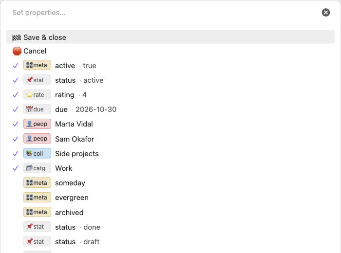

## インストール

Note Compass がコミュニティプラグインの一覧に掲載されたら、設定 → コミュニティプラグイン → 閲覧 を開き、「Note Compass」を検索してインストールし、有効にしてください。

手動でインストールする場合は、GitHub の最新リリースから `main.js`、`manifest.json`、`styles.css` をダウンロードします。

https://github.com/carlesba/obsidian-note-compass/releases/latest

3 つのファイルを `<vault>/.obsidian/plugins/note-compass/` に置き、Obsidian を再読み込みしてから、設定 → コミュニティプラグイン で Note Compass を有効にします。

Note Compass には Obsidian 1.13.0 以降が必要で、デスクトップとモバイルの両方で動作します。

## クイックスタート

これらのコマンドはキーボードから使うことを想定しているので、まずそれぞれにホットキーを割り当てましょう。設定 → ホットキー を開いて「Note Compass」を検索し、「ナビゲーション: デフォルト」「プロパティを設定」「フォームに入力」にキーを割り当てます。コマンドパレットから実行することもできます。

典型的な使い方は次のとおりです。今日のデイリーノートを開いて「ナビゲーション: デフォルト」のホットキーを押すと、昨日のノートや、今日のノートからリンクしたノートへ移動できます。作業中のノートで「プロパティを設定」のホットキーを押し、人の名前を数文字入力して選び、「保存して閉じる」を選びます。人物のように頻繁に作成するノートには、設定 → Note Compass → フォーム でフォームを追加しておきましょう。

デフォルトでは、「デフォルト」ナビゲーションピッカーに 4 つの関係リストが、「プロパティを設定」によく使うチェックボックスとリンクのプロパティが用意されています。設定 → Note Compass を開き、使わないものをオフにし、リンクプロパティの参照先を自分のフォルダやノートに変更してください。

設定 → Note Compass → タスク でコマンドを追加し、未完了のタスクがあるノートで「未完了のタスクを処理」を実行します。Enter で完了を保留し、`🏁 処理を終了` で保存します。

## ノートへ移動

「ノートへ移動」は、移動先のノートを選ぶピッカーを開きます。行を選ぶとそのノートがアクティブなタブで開きます。タブが開いていない場合は新しいタブで開きます。

設定 → Note Compass → ナビゲーション で、名前付きのナビゲーションピッカーを複数作れます。それぞれに専用のリストがあり、コマンドパレットに「ナビゲーション: <名前>」として表示されるので、個別にホットキーを割り当てられます。新規インストールでは「デフォルト」という 1 つから始まり、ナビゲーションピッカー導入前に保存したリストはそのままこれに移ります。「ノートへ移動」は「どのナビゲーションピッカーを開きますか？」と尋ね、オンのピッカーをすべて表示して、選んだものを開きます。

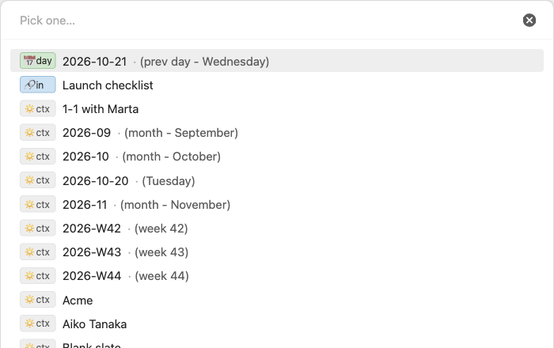

各ピッカーには、設定のそのピッカーのページで用意したリストが、設定した順に表示されます。使えるリストのうち 4 つはフォーカス中のマークダウンノートに依存するため、ほかのものにフォーカスがあるときやタブが開いていないときは表示されません。

- 前後の日付：フォーカス中のノートの直前と直後の日付ノートを、期間ごとに一覧にします。前後の日、週、月、四半期、年が対象です。例：`📅 day 2024-03-06 (翌日 - 水曜日)`、`📅 day 2024-W09 (前週 - 第9週)`。フォーカス中のノートより短い期間は省かれるので、週のノートでは日は表示されません。どの項目をどの順で表示するか、存在しないノートも表示するかは、リストのページで選びます。
- 発リンク：フォーカス中のノートからリンクしているノートを一覧にします。プロパティ内のリンクも含みます。
- 被リンク：フォーカス中のノートにリンクしているノートを一覧にします。
- 同じ日：フォーカス中のノートと同じ日に作成されたノートを一覧にします。日のノートの場合は、ファイルの作成日時ではなく名前の日付を使います。

ほかのリストはフォーカス中のノートに依存しません。

- フィルター：条件に一致するノートを一覧にします。たとえば `status` が `active` に等しいノート、`#project` タグの付いたノート、`work` 内で過去 1 週間に更新されたノートなどです。条件は「リストのページ」で説明するとおりグループにまとめられます。
- ノートへのリンク：選んだノートに本文またはプロパティでリンクしているノートを一覧にします。
- フォルダ内：フォルダとそのサブフォルダ内のノートを一覧にします。
- 今日更新：午前 0 時以降に変更されたノートを一覧にします。
- 現在の日付ノート：今日、今週、今月、今四半期、今年の日付ノートのうち、オンにしたものを一覧にします。名前順ではなく、リストのページで設定した順（既定では今日から今年まで）に並び、各行にはどの期間かが `今週 - 第10週` のように表示されます。まだ存在しないノートは、「まだ存在しないノートも表示」をオフにしていなければ `今週を作成` と表示され、選ぶと日付ノートのプラグイン（Periodic Notes、または日についてはコアのデイリーノート）と同じ方法・同じテンプレートで作成して開きます。カスタム書式の期間は空のノートとして作成されます。このソースを使うリンクプロパティには、存在するノートだけが表示されます。

ノートは、そのノートを含むすべてのリストの下に、リストの順で表示されます。フォーカス中のノートは除かれます。リスト内のノートは名前順に並びます。どのリストにもノートがない場合は、空のピッカーを開く代わりに「移動できるノートがありません。」と表示されます。

各行の先頭にはリストのプレフィックスが小さなチップとして表示され、名前と区別できます。ピッカー内のチップはすべて最も幅の広いチップ（最大 12 文字程度）と同じ幅になるので、名前の位置がそろいます。プレフィックスの色を設定したリストでは、チップに色が付きます。日付ノートには名前の後に期間が付きます。日のノートには曜日、週のノートには `第N週`、月のノートには `<月>`（`3月` など）、年のノートには `年` が付きます。

ノートを開かずにプロパティを編集するには、その行で ⌥↵（Alt+Enter）を押すか、行の末尾にあるスライダーアイコンをタップします。このアイコンはデスクトップではハイライト中の行に、スマートフォンではすべての行に表示されます。どちらの操作でも、フォーカス中のノートではなくそのノートの「プロパティを設定」が開きます。存在しない日付ノートを作成する行にはアイコンがありません。その「プロパティを設定」で Escape、`🛑 キャンセル`、`🏁 保存してリストに戻る` のどれを選んでも、入力していた内容を保ったまま移動リストに戻るので、複数のノートを続けて編集できます。

入力すると、文字の順序による一致で行が絞り込まれます。入力した文字が大文字・小文字を区別せず同じ順で含まれていれば、間にほかの文字があってもその行は残ります。プレフィックスも行の一部なので、プレフィックスの一部を入力するとそのリストに絞り込めます。

### 日付ノート

ノートがその期間に設定されたフォルダの直下にあり、名前がその期間の書式と完全に一致する場合、そのノートは日付ノートになります。期間は日、週、月、四半期、年の 5 つで、それぞれにフォルダ、書式、オン/オフのスイッチがあります。

設定のメインページにある「日付ノートの読み込み元」で、書式の読み込み元を選びます。「自動」は、Periodic Notes プラグインが有効ならそれを使い、次にコアのデイリーノートプラグイン、最後にこのプラグイン独自のカスタム書式を使います。デイリーノートは日だけを扱うので、ほかの期間はカスタムから読み込まれます。カスタムから読み込む期間がある場合は、「日付ノートの読み込み元」の横の鉛筆アイコンで書式を開き、各期間のフォルダと書式を Moment の書式で設定します。

https://momentjs.com/docs/#/displaying/format/

デフォルトでは、すべての期間が `on/` にあり、`2024-03-05`、`2024-W10`、`2024-03`、`2024` の形式です。`2024-Q1` のような四半期はオフになっています。

## プロパティを設定

「プロパティを設定」は、フォーカス中のマークダウンノートのプロパティを 1 つのピッカーから編集します。コマンドパレットには、マークダウンノートにフォーカスがあるときだけ表示されます。

ピッカーで作業している間は何も書き込まれません。最初の 2 行は常に `🏁 保存して閉じる`（変更したプロパティだけを書き込む）と `🛑 キャンセル`（すべての変更を破棄する）です。Escape はキャンセルと同じ動作です。⌘↵（Windows と Linux では Ctrl+Enter）を押すと、プロパティ自身のピッカーを含むどこからでも、その時点までの内容を保存してピッカーを閉じます。

続いて、ノートに保存される値がそれぞれ `✓` 付きで表示されます。リンクしたノートは 1 つにつき 1 行、チェックボックス、テキスト、数値、日付はそれぞれ値付きで 1 行です。このセッションで変更した値には `•` も付きます。設定済みのリンクを選ぶとそのリンクが削除され、複数リンクのプロパティからはそのノートだけが外れます。設定済みのテキスト、数値、日付を選ぶとその値のピッカーが開き、設定済みのチェックボックスは「チェックボックスの動作」の設定に従って動作します。

設定済みの値の下には、有効な各プロパティが追加できるものを設定の順に表示します。

- リンクまたは複数リンクのプロパティは、ソースのノートのうちまだ設定されていないものを、更新が新しい順に一覧にします。選ぶと、複数リンクのプロパティには追加され、リンクのプロパティでは保持しているノートが置き換えられます。リンクは `["[[Alice]]", "[[Bob]]"]` のようなリストとして保存され、ソースにないリンクがすでにプロパティにある場合はそのまま残ります。
- 未設定のテキスト、数値、日付、日付と時刻のプロパティは名前の行を 1 つ表示し、選ぶとそのプロパティ自身のピッカーが開きます。保管庫で使われている値は、ここではなくそのピッカーに表示されます。
- テキストと数値のプロパティは、メインメニューのスイッチがオンのプリセット値もここに表示するので、1 回の選択で値を設定できます。
- テキストのプロパティは、プリセットにない内容を入力すると `✏️ <プロパティ>: 「<入力した内容>」を使用` も表示します。
- 未設定のチェックボックスは名前の行を 1 つ表示します。デフォルトでは選ぶとそのピッカーが開きます。「true と未設定を切り替える」では、選ぶと `true` になり、`true` のときにもう一度選ぶとクリアされます。「true、false、未設定を順に切り替える」では、選ぶたびに未設定 → `true` → `false` → 未設定と 1 段階ずつ進みます。

何も入力していないときは、各プロパティにつき最大 5 つの値と `… ほか N 件、入力して絞り込み` が表示されます。この行を選ぶとプロパティのプレフィックスが自動で入力されます。入力を始めると、一致する行がすべて表示されます。値を選ぶとフィルターがクリアされた状態でピッカーが再び開くので、`🏁 保存して閉じる` が先頭に戻り、選んだ値はその下に設定済みとして表示されます。

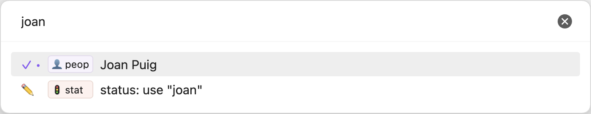

「複数のプロパティ」モードの行は、`status: done`、`archived: true`、`active` なし、のように複数のプロパティを 1 回の選択で設定します。値はそのプロパティのページで固定されているので、ピッカーで尋ねられることはありません。行はピッカーの 1 つの選択肢で、「名前」で表示されます。名前が空のときは `status done, archived ✓, active クリア` のような値の要約で表示され、プロパティは通常の色、値はグレーになります。ノートがすべての値を満たしていない間、行は追加できる値の中に表示され、選ぶとすべての値が一度に適用され、フィルターがクリアされた状態でピッカーが再び開きます。ノートがすべての値を満たすと、行は設定済みの値の中に `✓` 付きで表示され、ピッカーを開いたときに満たしていなかった場合は `•` も付きます。このとき選んでも何も変わりません。複数リンクの値はそのノートを追加してほかのリンクを残し、リンクの値はノートを置き換え、クリアの値はプロパティを削除します。今日と現在はピッカーを開いたときに決まります。行は全部か無かで、すべての値を満たしたときだけ設定済みになり、保存するまで何も書き込まれません。

プロパティ自身のピッカーでは、現在の値に `✓` が付き、最後に `🗑️ クリア` があります。これを選ぶとプロパティが削除されます（「空になったら削除」がオフの場合は空のまま残ります）。Escape を押すと、そのプロパティを変更せずにメインのピッカーに戻ります。メインのピッカーですでに行った変更は保持されます。

- チェックボックスは `true` と `false` を表示します。
- テキストは、新しい値として `✏️ 「<入力した内容>」を使用` を表示し、続いてプリセット値、最後に保管庫でそのプロパティに使われているほかの値を使用頻度の高い順に、使用回数とともに表示します。
- 数値は、数値として `✏️ 「<入力した内容>」を使用` を表示し、続いてプリセット値、最後に保管庫でそのプロパティに使われているほかの数値を使用頻度の高い順に表示します。
- 日付は、`YYYYMMDD` または `YYYY-MM-DD` の形式で入力した日付に対する「使用」の行を表示し、続いて今日、明日、次の月曜日、1週間後を表示します。保存形式は `YYYY-MM-DD` です。
- 日付と時刻は、`YYYYMMDDHHmm`、`YYYYMMDD HHmm`、`YYYY-MM-DD HH:mm`、`YYYY-MM-DDTHH:mm` に対する「使用」の行を表示し、続いて現在を表示します。保存形式は `YYYY-MM-DDTHH:mm` です。

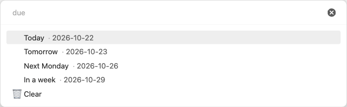

リンクプロパティには、フォーカス中のノートとプロパティの除外フォルダ内のノートは表示されません。アーカイブ済みのノートなどを隠すには、「次のいずれも真ではない」グループに `archived true である` を入れたフィルターをソースにします。ピッカーがリンクできるのは既存のノートだけなので、新しいノートをリンクするには先にフォームで作成してください。

## フォーム

フォームは、いくつかの質問から新しいノートを 1 つ作成します。たとえば、本と著者を尋ねる読書記録や、議題と参加者を尋ねる会議ノートです。フォームは 設定 → Note Compass → フォーム で定義します。「フォームに入力」は有効なフォームを一覧にし、選んだフォームを実行します。有効なフォームはそれぞれ、フォーム名を付けた専用のコマンドにもなるので、ホットキーを割り当てられます。ほかのコマンドと同じく、フォーカス中のノートがあってもなくても使えます。フォームがない場合、「フォームに入力」は「フォームはまだありません。設定 → Note Compass → フォーム で追加してください。」と表示します。

フォームは、質問のフィールドごとに 1 つずつ、「フィールド」リストの順に質問します。Escape で前の質問に戻り、最初の質問で Escape を押すとノートを作成せずにフォームを閉じます。戻っても入力済みの回答は残り、チェックが付いて表示されます。

最後の質問のあとに確認画面が開きます。最初の行は `✅ 「<名前>」を作成` で、回答から決まるノート名が入ります。続いてフィールドごとに 1 行ずつ、入る値か `スキップ` が表示され、最後に `🛑 キャンセル` があります。質問のフィールドを選ぶとその質問がもう一度開き、回答すると確認画面に戻ります。確認画面で Escape を押すと最後の質問に戻り、質問のないフォームでは閉じます。⌘↵（Windows と Linux では Ctrl+Enter）を押すと、必須の質問すべてに回答があれば、どの質問からでもノートを作成します。

ノートはフォームの「フォルダ」に作成され、空の場合は Obsidian が新しいノートを置く場所に作成されます。そこに同じ名前のノートが（大文字と小文字を区別せずに）すでにある場合、新しいノートには `Dune 2` のように番号が付きます。先にノートの本文が書き込まれ、次にフィールドの順にプロパティが書き込まれます。その後 Note Compass が `「Dune」を reading に作成しました。` のように作成場所を知らせ、「作成後にノートを開く」がオフでなければノートを開きます。

### フォームのページ

フォームのページには次の項目があります。

- 「有効」：フォームを「フォームに入力」とコマンドに表示します。
- 「名前」：「フォームに入力」とコマンド名に表示されます。
- 「ノート名」：新しいノートの名前のパターンです。例：`{{date:YYMMDDHHmm}} {{book}}`。空のプレースホルダーで重なったスペースは 1 つにまとめられます。名前が空になったり、Obsidian がファイル名に使えない文字を含んだりした場合はメッセージとともに拒否され、確認画面にとどまります。
- 「ノートの内容」：新しいノートの本文です。同じプレースホルダーを使えます。
- 「フォルダ」：新しいノートの作成場所です。
- 「作成後にノートを開く」：デフォルトでオンです。
- 「フィールド」：フォームが入力する値や質問する値です。この順序が質問の順序になります。

フィールドのリストは設定のほかのリストと同じように使えます。ハンドルをドラッグして並べ替え、コピーアイコンでフィールドをすぐ下に複製し、× でフィールドを削除し、見出しの `+` で追加します。`+` を押すとメニューが開きます。「空のフィールド」は空のテキストの質問フィールドを追加し、「日付」「時刻」「タイムスタンプ」「ISO タイムスタンプ」は作成時の値が入る固定のフィールドを追加します。キーは `date`、`time`、`timestamp`、`iso-timestamp`、形式は `YYYY-MM-DD`、`HH:mm`、`YYYY-MM-DDTHH:mm`、ISO 8601 です。各項目には今の時点で書き込まれる値が表示され、すでに使われているキーには `timestamp-2` のように番号が付きます。「エントリーの日付を確認」と「エントリーの時刻を確認」は質問変数 `entry-date` と `entry-time` を追加します。両方を使えます。

確認には日付を `YYYYMMDD`、時刻を `HHmm` のテキストで入力します。下の選択肢は完全な `YYYY-MM-DD HH:mm` を表示し、Enter で表示値を保持します。日付の変更は時刻を、時刻の変更は日付を保持し、最終確認で両方を編集しても維持します。組み合わせた日時を `{{date}}`、`{{time}}`、ノート名、「作成時」の固定フィールドに使います。既存の設定も保持され、日時型は日時全体を変更します。同じ部分を変更するフィールドが重なる場合のみ警告します。各行にはフィールドのキーが表示され、その後に保存先、モード、種類を示す小さなバッジが `book` `変数` `質問` `テキスト` のように続きます。プロパティのバッジは青、変数のバッジは紫です。行かその矢印をクリックするとすぐ下でフィールドを編集でき、もう一度クリックすると閉じます。一度に開けるフィールドは 1 つだけで、新しいフィールドはすぐに開きます。

名前と内容では次のプレースホルダーを使えます。

- `{{date}}` と `{{time}}` はフォームを開始した時刻で、コアのテンプレートプラグインで設定された書式になります。`{{date:FORMAT}}` と `{{time:FORMAT}}` は指定した書式を使います。
- `{{key}}` は `key` という名前のフィールドの値です。リストはカンマでつながれ、スキップしたフィールドは空になります。
- `{{key:FORMAT}}` は日付や時刻のフィールドを指定した書式で表します。例：`{{started:dddd}}`。
- `{{title}}` は内容でのみ使え、新しいノートの名前になります。

それ以外のプレースホルダーはそのまま残ります。

### フィールド

各フィールドには「キー」、「保存先」、「入力するのは」、質問のフィールドでは「質問」、そして「フィールドの種類」があります。「キー」はプロパティ名または変数名で、どちらの場合も `{{key}}` として使います。「保存先」は、値をキーの名前で新しいノートのプロパティに書き込む「プロパティ」（デフォルト）か、名前と内容のプレースホルダーを埋めるだけで書き込まれない「変数」です。「入力するのは」は「固定値」か「質問」です。

固定のフィールドは、テキスト、数値、チェックボックス、リスト、日付、時刻、日付と時刻のいずれかです。数値は数値だけを受け付け、チェックボックスにはスイッチがあります。リストには入力欄があり、各項目はチップとして表示されます。項目を入力して Enter で追加し、× で削除します。項目はリンクにもできるので、`[[Books]]` と `[[Reading]]` は `categories: ["[[Books]]", "[[Reading]]"]` を書き込みます。これでフォームのノートをほかのノートにリンクできます。固定のテキストの値やリストの入力欄で `[[` と入力すると保管庫のノートが候補に表示され、選ぶと `[[Books]]` のようにそのリンクが書き込まれます。フォルダが付くのは同じ名前のノートが 2 つあるときだけです。リストの入力欄では、選んだリンクがすぐにチップになります。

質問のフィールドは、テキスト、数値、チェックボックス、選択、複数選択、日付、時刻、日付と時刻のいずれかです。「質問」は表示される問いかけで、空の場合はフィールドのキーになります。「任意」にすると質問の先頭に `⏭️ スキップ` が表示されます。スキップしたプロパティはまったく書き込まれず、スキップした変数は空になります。テキストや数値の質問には何でも入力でき、テキストや数値のプロパティには、保管庫でそのプロパティに使われている値も表示されます。

選択と複数選択には「選択肢」があり、それぞれに値と省略可能なラベルがあります。「選択肢」の見出しの `+` で追加し、× で削除し、選択肢のハンドルをドラッグして並べ替えます。質問にはラベルが表示され、ラベルがなければ値が表示されます。ノートに入るのは値です。複数選択の質問では選択肢を複数選べ、選んだものにはチェックが付きます。最後に `🏁 完了` を選びます。「選択肢の値の型」は値をテキストか数値として書き込むので、値が `4` でラベルが `4 · 最高` の選択肢は数値の 4 を書き込めます。

日付、時刻、日付と時刻のフィールドには「書式」があります：`YYYY-MM-DD`、`HH:mm`、`YYYY-MM-DDTHH:mm`、ISO 8601、またはカスタムの Moment.js 書式です。固定のものは「値」を「作成時」（フォームを開始した時刻）、「指定した日時」（その下に入力する日時）、「フィールド … から」（フォームの別の日付・時刻フィールドの値）のいずれかから取ります。指定した日時は数字で、日付なら `YYYYMMDD`、時刻なら `HHmm`、日付と時刻なら `YYYYMMDDHHmm` の形式で入力します。ハイフンやコロンを含めても構いません。その下の行には、`✓ Mon 30 Oct 2028, 09:00` のように読み取った結果が表示されます。これで、質問した 1 つの時刻から、`YYYY-MM-DD` の `day` と ISO 8601 の `timestamp` のように複数のプロパティを作れます。元のフィールドがスキップされた場合は、こちらもスキップされます。質問のものには「現在」が表示され、日付ではさらに「今日」、「明日」、「次の月曜日」、「1週間後」も表示されます。「プロパティを設定」の日付ピッカーと同じく、`20240311`、`2024-03-11`、`0930`、`09:30`、`202403110930`、`20240311 0930` と入力することもできます。時刻は今日のその時刻になります。

ブロックは、前の回答が一致したときだけフォームが使うフィールドをまとめます。たとえば、本についてのノートのときだけページ数を尋ねられます。「フィールド」の見出しの `+` メニューの「条件付きブロック」で空のブロックを末尾に追加し、ブロックの下端の `+` でその中にフィールドを追加します。フィールドをブロックの見出しと下端の行の間にドラッグすると中に入り、外へドラッグすると戻ります。見出しをドラッグするとブロック全体が移動し、ブロックを別のブロックの中には入れられません。ブロックを削除しても、そのフィールドはリストに残ります。見出しをクリックすると条件を編集できます。各条件は、ブロックより上のフィールド、フィールドの種類に応じた「等しい」「項目を含む」「=」「より前」「設定済み」などの判定、多くの場合は値を選びます。選択のフィールドでは選択肢が値として表示され、日付や時刻は `YYYYMMDD`、`HHmm`、`YYYYMMDDHHmm` で入力します。ブロックはすべての条件を満たすときだけ使われます。使われないブロックの質問は尋ねられず、フィールドは確認画面に表示されず、書き込まれず、プレースホルダーは空になります。複数のフィールドが同じキーを使えます（2 つのブロックそれぞれの `categories` など）。値のある最後のフィールドが優先され、スキップしたフィールドは前のフィールドの値を消しません。

キーのないフィールド、選択肢のない選択、日付ではないフィールドから取る日付には、フィールドの行とフォームに警告が表示されます。条件やフィールドのないブロック、フィールドや値のない条件、ブロックより上にないフィールドへの条件、フィールドの種類に合わない条件には、ブロックの行とフォームに警告が表示されます。このバージョンの Note Compass が読み込めないフォームは、読み込めないリストと同じく、オフのまま警告付きで鉛筆アイコンなしでリストに残り、保存された設定は削除するまで保持されます。

## タスクコマンド

自分で定義したコマンドパレットのコマンドで、アクティブな Markdown ノートのタスクを処理します。

### クイックスタート

設定 → Note Compass → タスク の `+` でコマンドを追加し、名前を付けます。Markdown ノートを開き、その名前をコマンドパレットから実行します。ホットキーも割り当てられます。有効でアクションが1つ以上あるコマンドだけが表示されます。対象タスクがなければ、空の選択画面の代わりに通知が出ます。

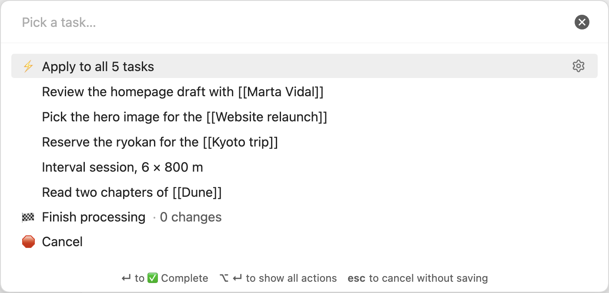

### コマンドのページ

| 設定 | 動作 |
| --- | --- |
| 有効 | このタスクコマンドを独立したコマンドとして表示します。 |
| 名前 | コマンドパレットでコマンド名として表示されます。 |
| 表示するタスク | 空にするとすべてのタスクを表示します。 |
| 除外するタスク | 表示対象でも除外します。空にすると何も除外しません。 |
| すべて選択 | 表示中のすべてのタスクにアクションを適用する行を先頭に追加します。 |
| 一括モード | 終了するかタスクがなくなるまで、アクションを保存せずに保留します。キャンセルまたは Esc で保留中の変更をすべて破棄します。 |
| キー割り当て | Enter、Cmd+Enter（Windows と Linux では Ctrl+Enter）、Alt+Enter、Shift+Enter に、アクション、「アクションメニューを表示」、または一括モードでは `🏁 処理を終了` を割り当てます。`+` で追加し、× で削除します。各キーは 1 回だけ使えます。割り当てのないキーはアクションメニューを開くため、リストが空ならどのキーでもメニューが開きます。アクションを削除すると、そのキーの割り当ても消えます。 |

「ステータスを追加」では 未完了 `[ ]`, 完了 `[x]`, キャンセル済み `[-]`, 移行済み `[>]`, 予定済み `[<]`, 進行中 `[/]` と「カスタム…」を選べます。カスタムは1文字入力して Enter で追加し、チップの × で削除します。大文字と小文字は区別され、除外が優先されます。

フォームとタスクの行は名前だけを表示します。2行目は警告があるときだけで、設定の要約は表示しません。
読み込めないコマンドは、削除するまでオフのまま警告付きで保持されます。

### アクション

各アクションには「ラベル」、1つの「アクション」の種類、1文字の「状態」があります。`+` で追加、ドラッグで並べ替え、コピーで複製、× で削除し、行をクリックすると直下で編集できます。

#### 状態を変更

元の行のチェックボックスの文字を変更します。「完了日」で末尾への追加を選べます。

| 完了日 | 追加するテキスト |
| --- | --- |
| オフ | なし。 |
| 日付 | ` ✅ 2028-10-30` |
| 日付のリンク | ` ✅ [[2028-10-30]]` |
| 日時 | ` ✅ 2028-10-30 09:00` |

例の日付には「日付ノート」の日次書式を使い、元のノートの日付ではなく今日を使います。日時はコアのテンプレートプラグインの時刻書式を追加します。日付リンクはノートを作成しません。

#### ノートにコピー

別のノートの末尾に未完了のタスク `[ ]` を追加し、元の「状態」を変更します。タスクの1行だけをコピーし、子タスクや続きの行、インデント、引用の接頭辞はコピーしません。

- 「コピー先」は独立したページを開きます。`+` で追加、ドラッグで並べ替え、× で削除し、戻る矢印でコマンドに戻ります。
- コピー先タスクの接頭辞・接尾辞はコピーの本文だけにそのまま付き、ブロック ID とコピー元リンクの前に入ります。空白も入力してください。初期値は空で、即時処理と一括処理の両方で使えます。
- 「コピー先へのリンク」は元のタスクに ` → [[コピー先]]` を、「コピー元へのリンク」はコピーに ` ← [[コピー元]]` を追加します。
- 期間は元のノートの日付ではなく今日が基準で、「日付ノート」の有効な期間、フォルダー、書式を使います。利用できるコピー先が1つなら直接実行し、複数なら設定順に「どのノートにコピーしますか？」を開きます。元のノートと重複するコピー先は表示しません。
- 存在しない特定のノートは通知して除外します。コピー先が残らなければ何も変更しません。
- 存在しない定期ノートは保存時に作成します。「日付ノート」が Periodic Notes を使う場合、まずそのプラグインにテンプレート付きでの作成を依頼します。API がない、失敗する、または期待したパスに作成されない場合は空のノートを作ります。コアのデイリーノートやカスタムを含む他のソースでは、空のノートにタスクを追加します。

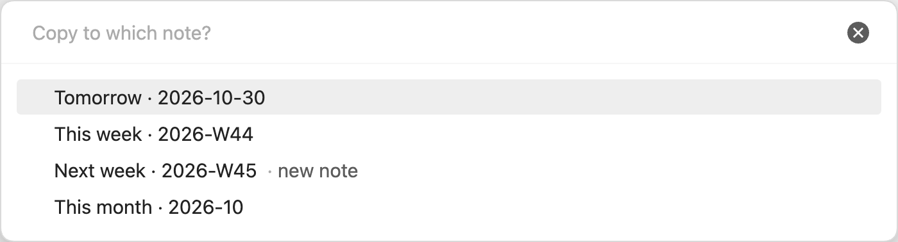

### 選択画面と一括モード

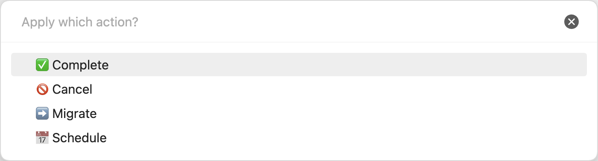

- 入力するとタスクのテキストを、大文字小文字を区別せず文字の順序で絞り込みます。「キー割り当て」のキーは割り当てた動作を実行し、それ以外のキーと ⚙ はすべてのアクションを開きます。
- 「すべて選択」は検索に一致するタスクが複数あるとき `⚡ N 件すべてのタスクに適用` を追加します。ノート全体ではなく検索に一致するものだけが対象です。
- 「一括モード」では選択を保留し、残りのタスクと空の検索で選択画面を開き直します。`🏁 処理を終了` · N 件の変更 で保存し、タスク選択画面の `🛑 キャンセル` または Escape ですべて破棄します。アクションやコピー先の選択画面で Escape を押すと、保留中の変更を保持して戻ります。
- 最後のタスクを処理すると自動で保存して終了します。`⚡ N 件すべてのタスクに適用` も、検索で他のタスクが隠れていてもすぐに保存して終了します。
- 「一括モード」がオフなら、1回の選択をすぐに書き込み、画面を閉じます。Escape では元に戻せません。どちらのモードでも、選択画面を開いた後で変更された元の行は通知してスキップします。

### 新規コマンドのデフォルト

新規コマンドは Bullet Journal の設定で、名前は「未完了のタスクを処理」です。有効で、未完了 `[ ]` のみ表示、除外なし、「すべて選択」はオフ、「一括モード」はオンです。「キー割り当て」は Enter を「✅ 完了」に割り当てるので、Alt+Enter、Cmd+Enter、Shift+Enter はアクションメニューを開きます。

| アクション | 元の状態 | その他の設定 |
| --- | --- | --- |
| ✅ 完了 | `[x]` | 完了日：オフ。 |
| 🚫 キャンセル | `[-]` | 完了日：オフ。 |
| ➡️ 移行 | `[>]` | 明日, 今週, 来週, 今月; コピー先だけにリンク。 |
| 📅 予定に入れる | `[<]` | 来月, 来四半期, 来年; コピー先とコピー元にリンク。 |

この初期値は新しいコマンドだけに適用され、保存済みのコピー先は変わりません。

### 既知の動作
- 複数ノートへの書き込みは不可分ではありません。失敗すると一部だけが更新されることがあります。
- コピーは既存の接尾辞やブロック ID を含む行のテキストを保持します。ブロック ID は再生成されず重複します。

## 設定

設定は狭いウィンドウにも収まり、モバイルでも同じように使えます。メインページの冒頭には、「ナビゲーション」、「プロパティ」、「フォーム」、「タスク」の 4 つのページの内容を説明する短い案内があり、その下にこの 4 つのページ、「連携」グループの「日付ノートの読み込み元」、最後に「すべての設定をリセット」があります。

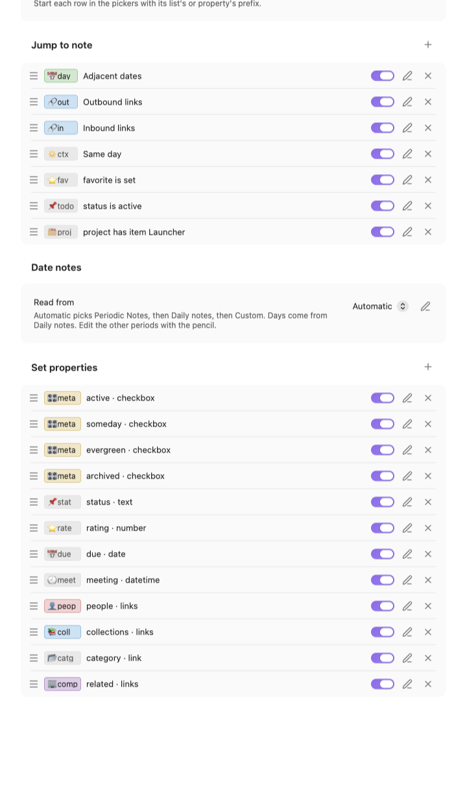

4 つの行のどこをクリックしてもそのページが開き、上部の戻る矢印で戻れます。行自身のページはそのセクションの中で開くので、リストのページから戻るとそのナビゲーションピッカーのページに、もう一度戻ると「ナビゲーション」のページに戻ります。このページにはナビゲーションピッカーが並び、追加、並べ替え、オンオフ、編集、コピー、削除の操作はほかの一覧と同じです。各ピッカーには「有効」「名前」「フィルター」とそのリストがあります。ピッカーのフィルターは、各リストのソースやフィルターに加えてすべてのリストに適用され、一致するノートだけが表示されます。空なら何も隠しません。新しいピッカーはリストなし、フィルターは空で始まり、コピーアイコンはフィルターとリストごと複製します。

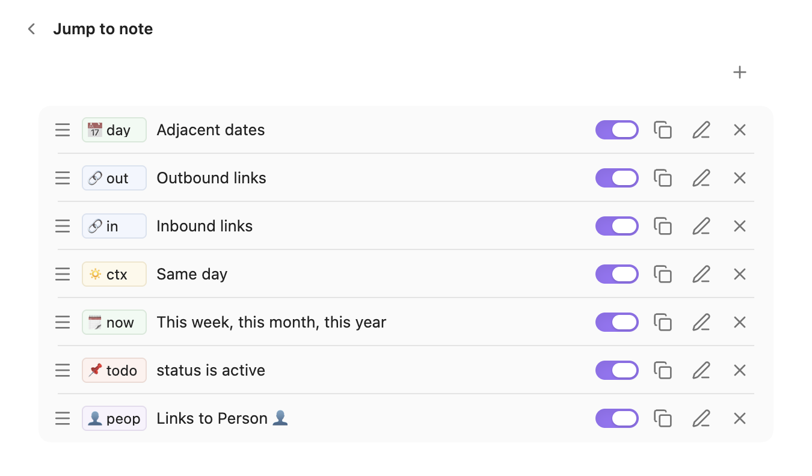

### フォームとタスク

他のリストと同じ追加、並べ替え、有効化、編集、複製、削除の操作を使います。コマンドのページにはコマンド、表示するタスク、除外するタスク、オプション、アクションがあります。追加するまでタスクコマンドはなく、新規コマンドは Bullet Journal のアクションで始まります。

フォームとタスクの行は名前だけを表示します。2行目は警告があるときだけで、設定の要約は表示しません。

### リストとプロパティ

ナビゲーションピッカーのページと「プロパティ」のページはどちらも行のリストで、行の扱い方は同じです。各行には、プレフィックスのチップと、一覧にする内容または書き込む内容（`status 等しい active` や `people · 複数リンク` など）が表示されます。

- 左側のハンドルをドラッグして行を並べ替えます。この順序がピッカーでの順序になります。
- スイッチで、設定を失わずに行をピッカーに表示したり非表示にしたりします。
- 鉛筆アイコンで行のページを開き、× で削除します。
- コピーアイコンで行を複製します。複製は同じ設定ですぐ下に追加され、フォームの複製は `<名前> のコピー` という名前になります。
- リストの上の `+` で行を追加します。ページがすぐに開いて入力でき、新しい行は最初からオンになっています。

新しいバージョンで保存された行など、このバージョンの Note Compass が読み込めない行は、「このリストはこのバージョンの Note Compass では読み込めません。削除して新しく作成してください。」という警告とともにリストに残ります。スイッチはオフのまま無効になり、鉛筆アイコンもないので、ピッカーにノートが追加されることはありませんが、保存された設定は削除するまでそのまま保持されます。

プレフィックスのチップをクリックまたはタップするか、チップにフォーカスして Enter を押すと、そのメニューが開きます。スマートフォンでは、メニューは下から出るシートとして表示されます。メニューにはすべてのナビゲーションピッカーと「プロパティ」のページで使われているプレフィックスがすべて並び、それぞれチップと、それを使っている行数が続きます（`📅 due` のチップに `· 3 行` など）。使われている数が多い順です。その行自身のプレフィックスにはチェックが付きます。いずれかを選ぶと、そのテキストと色がこの行にだけ設定され、ほかの行は変わりません。「プレフィックスを編集…」はその行のページを開き、「プレフィックス」にカーソルを置きます。「プレフィックスなし」は行にプレフィックスがあるときだけ表示され、テキストと色を消去します。空のプレフィックスは薄い `プレフィックス` のチップとして表示され、メニューには並びません。

テキストと色の両方が同じとき、行どうしは同じプレフィックスを共有します。そのため、赤い `👤 peop` と色のない `👤 peop` は別のプレフィックスです。

### リストのページ

リストのページには「有効」「プレフィックス」があり、続いて「ソース」でリストの内容を選びます。選択肢は、前後の日付、発リンク、被リンク、同じ日、フィルター、ノートへのリンク、フォルダ内、今日更新、現在の日付ノートです。前後の日付と現在の日付ノートには、ソースの下に 2 つの設定が加わります。「まだ存在しないノートも表示」がオフのときは存在する日付ノートだけを表示し、オンのときは `翌週を作成` のように存在しないノートも表示して、選ぶと作成します。既定では前後の日付はオフ、現在の日付ノートはオンです。「一覧にするノート」には項目ごとに 1 行ずつあり、既定ですべてオンです。前後の日付では「前日」「翌日」から「前年」「翌年」まで、現在の日付ノートでは「今日」から「今年」までです。行のハンドルをドラッグするとピッカーでの並び順が変わり、行をオフにするとその項目は表示されません。存在しない前後の日付ノートは、日付ノートのソースが Periodic Notes のときはそのテンプレートで作成され、それ以外は空のノートとして作成されます。

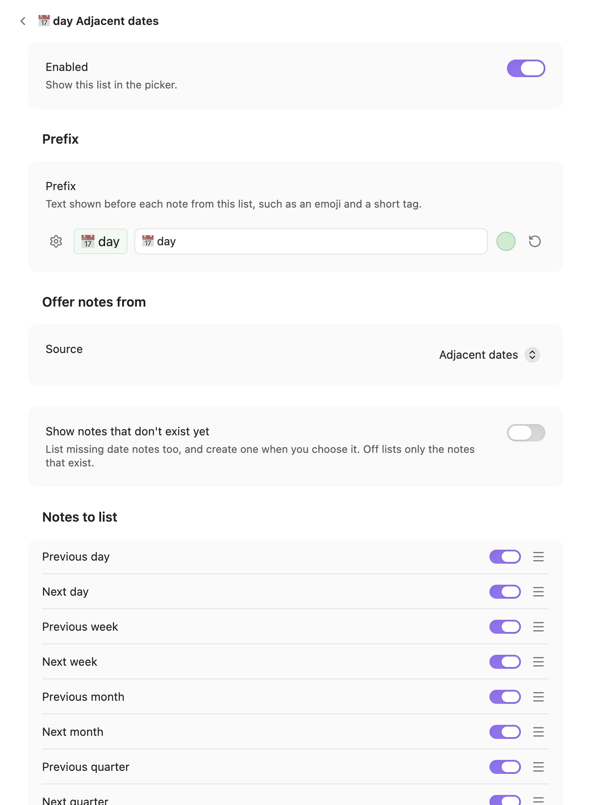

リストやプロパティのページでは、「プレフィックス」に設定ボタン、チップのプレビュー、テキスト、色が表示されます。入力したテキストと選んだ色は、この行と、ページを開いたときに同じプレフィックスを使っていたすべての行に反映され、説明にはそれらの行が示されます（「ほかの 2 行でも使用中：people · 複数リンク, 発リンク」など）。テキストが一時的に空になっても、それらの行はまとまったままです。円形の矢印で色を削除できます。

設定ボタン（「プレフィックスを選択」）を押すと、プレフィックスのメニューが開きます。いずれかのプレフィックスを選ぶと、そのテキストと色がこの行に設定され、ほかの行は変わりません。「新しいプレフィックス…」は行にプレフィックスがあるときだけ表示され、それを空にするので、そのあとの入力と選択はこの行だけに反映されます。「プレフィックスなし」は行にプレフィックスがあるときだけ表示され、テキストと色を消去します。

フィルターは Obsidian のベースのフィルターと同じように動作し、見た目も同じです。フィルターは「次のすべてが真」「次のいずれかが真」「次のいずれも真ではない」で始まるグループで、ノートがグループ内のすべてのフィルターに一致する場合、少なくとも 1 つに一致する場合、どれにも一致しない場合に、そのノートが一覧に表示されます。各フィルターの行は、調べる対象から始まります。プロパティ名を入力するか、候補から `フォルダ`、`タグ`、`リンク`、`作成日時`、`更新日時` を選びます。続いて演算子と値を選びます。たとえば「フォルダ」「含まれる」「projects」、「タグ」「タグを含む」「client」、「更新日時」「より後」「7 日前」のようになります。「フィルターを追加」でグループに行を追加し、「フィルターグループを追加」でグループ内に独自の選択を持つグループを追加します。グループは、フィルター自体を含めて 3 階層まで入れ子にできます。行や内側のグループのゴミ箱ボタンで削除でき、内側のグループの最後の行を削除するとグループも削除されます。新しいフィルターには行がなく、行を追加するまで何も一覧に表示されません。フィルター内の空のグループは照合の対象外になります。

各条件は、まず何を調べるかを選びます。

- プロパティ：プロパティを、そのタイプで使える条件で調べます（後述）。
- フォルダ：「含まれる」でフォルダとそのサブフォルダ内のノートに、「含まれない」でそれ以外のすべてのノートに一致します。
- タグ：プロパティまたは本文にタグがあるノートに一致します。タグはサブタグにも一致するので、`project` は `#project/website` に一致します。大文字・小文字や先頭の `#` は区別しません。「タグを含まない」はそのタグがないノートに一致します。
- リンク：選んだノートに本文またはプロパティでリンクしているノートに一致し、「含まない」はリンクしていないノートに一致します。
- 作成日時と更新日時：ノートが作成された日または最後に変更された日を、固定の日付または今日を基準にした日付と、「当日」「当日以外」「より前」「より後」で比較します。

リストの行には、フィルターの条件が 1 つだけなら `status 等しい active` や `タグ project あり` のようにその条件が、複数なら `3 件の条件をすべて満たす` のように条件の数が表示されます。

以前のバージョンで「Notes with a property」として保存されたリストは、そのプロパティの条件を 1 つ持つフィルターとして開き、以前と同じノートを一覧にします。

プロパティの条件では、まずプロパティを選びます（保管庫のプロパティがタイプとともに候補に表示されます）。続いて、そのタイプで使える条件を選びます。

- チェックボックスのプロパティ：true、false、設定済み、未設定。「false である」には明示的な `false` が必要です。
- テキストのプロパティ：値に等しい、等しくない、値を含む、含まない、設定済み、未設定。
- リスト、タグ、エイリアスのプロパティ：値に等しい項目を含む、含まない、設定済み、未設定。ウィキリンクはリンクテキストで比較されるので、`[[Project]]` は値 `Project` に一致します。
- 数値のプロパティ：数値と等しい（`=`）、等しくない（`≠`）、より小さい（`<`）、より大きい（`>`）、設定済み、未設定。
- 日付のプロパティ：固定の日付、今日、または何日前・何日後の日付に対して、当日、当日以外、より前、より後、設定済み、未設定。相対的な日付はピッカーを開くたびに計算されます。

「未設定」は、空欄のままのプロパティにも一致します。「等しくない」や「含まない」のような否定の条件は、肯定の条件に一致しないすべてのノートに一致し、そのプロパティがないノートも含みます。

### プロパティのページ

プロパティのページには「有効」と「ラベル」グループがあります。「ラベル」には、リストのページと同じ「プレフィックス」と、「複数のプロパティ」モードでは行の「名前」が入ります。続く「モード」は「単一のプロパティ」（デフォルト）か「複数のプロパティ」です。「単一のプロパティ」モードでは、続いて「プロパティ」と「タイプ」があります。「プロパティ」には保管庫のプロパティがタイプとともに候補に表示され、選ぶとタイプが自動的に合わせられます。チェックボックス、数値、日付、日付と時刻はそのまま、リストとタグは複数リンクに、それ以外はテキストになります。「タイプ」はチェックボックス、テキスト、数値、日付、日付と時刻、リンク（1つのノート）、複数リンク（複数のノート）から選べ、プロパティを選ぶまでは無効です。

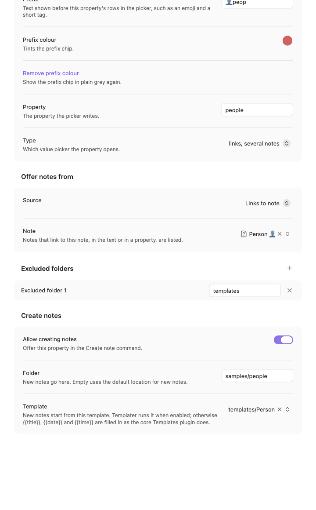

すべてのプロパティに「空になったら削除」があります。デフォルトでオンで、値をクリアしたり最後のリンクを削除したりすると、ノートからプロパティを削除します。オフにすると、プロパティは空の値のままノートに残ります。

テキストと数値のプロパティには「プリセット値」もあります。これはプロパティ自身のピッカーが最初に表示する値のリストで、たとえば `status` プロパティなら `todo`、`doing`、`done` のようなものです。見出しの `+` で、値を入力するテキスト欄とスイッチを持つ行が追加されます。行はドラッグしてピッカーでの表示順に並べ替えられ、それぞれ削除できます。数値のプロパティでは、数値として書かれた値だけが保持されます。プリセットは制限ではなく補助です。プリセットの後には、保管庫でそのプロパティに使われているほかの値が使用頻度の高い順に表示され、入力した内容も使えます。プリセットの横のスイッチをオンにすると、メインの「プロパティを設定」メニューにも表示されます。プリセットをたくさん用意しておき、よく使うものだけを 1 回の選択で設定できるようにしておけます。プリセットはすべて、そのプロパティ自身のピッカーに常に表示されます。

リンクまたは複数リンクのプロパティには、さらに 2 つのセクションがあります。

- 「ノートの取得元」：ピッカーに表示するノートを選びます。ソースは移動リストと同じです。
- 「除外フォルダ」：ノートを表示しないフォルダを一覧にします。見出しの `+` でフォルダを追加し、各行は削除できます。空の行は何も除外しません。

「複数のプロパティ」モードの行は、ページで固定した値で複数のプロパティを一度に書き込み、「プロパティを設定」のピッカーでは 1 つの選択肢として表示されます。モードを「単一のプロパティ」に戻すと単一のプロパティの設定が戻り、固定した値は次に切り替えるときのために保存されたままです。「名前」はピッカーでこの行に表示される名前で、空のときは値の要約が表示されます。この要約は欄のプレースホルダーにもなります。「設定する値」にはプロパティごとに 1 つのブロックがあります。見出しの `+` でブロックを追加し、ブロックはドラッグ、複製、削除できます。各ブロックには `status done`、`archived ✓`、`active クリア` のようにプロパティと値が表示され、クリックすると編集欄が開きます。

- 「プロパティ」：書き込むプロパティです。フォーカスすると保管庫のプロパティが一覧表示され、選ぶとタイプが合わせられます。新しい名前も使えます。
- 「タイプ」：チェックボックス、テキスト、数値、日付、日付と時刻、リンク（1つのノート）、複数リンク（複数のノート）、「クリア（プロパティを削除）」から選べます。
- 「値」：チェックボックスならスイッチ、テキスト、数値、今日か固定の日付、現在か固定の日時、リンクと複数リンクならノートです。クリアには値がありません。

リンクの値はプロパティが保持しているノートを置き換え、複数リンクの値はそのノートをリストに追加します。プロパティか値のないブロックはスキップされます。

デフォルトの `related` の行のように、ソースの異なる複数の行が同じプロパティに書き込むこともあります。それらの行は 1 つの値を共有し、タイプは最初に有効になっている「単一のプロパティ」モードの行で決まります。同じプロパティの 2 つの行でタイプが食い違う場合は、行に警告が表示されます。

### チェックボックスの動作

「プロパティ」ページのリストの下にある「チェックボックスの動作」は、メインの「プロパティを設定」メニューでチェックボックスのプロパティを選んだときの動作を、すべてのチェックボックスのプロパティについて決めます。選択肢は、true、false、クリアのピッカーを開く（デフォルト）、true と未設定を切り替える、true、false、未設定を順に切り替える、の 3 つです。0.6.1 または 0.6.2 で個々のプロパティに設定したモードは、この設定に引き継がれます。

### すべての設定をリセット

メインページの一番下にある「すべての設定をリセット」は、すべてのリスト、プロパティ、フォーム、オプションをデフォルトに戻します。デフォルトにはフォームはありません。実行前に確認があり、キャンセルか Escape で何も変更せずに戻れます。リセットは元に戻せません。

リセットはタスクコマンドも削除します。デフォルトにはタスクコマンドはありません。

## 言語

Note Compass は、Obsidian で選んだ言語に従います。英語、スペイン語、簡体字中国語、繁体字中国語、日本語、韓国語に対応しており、それ以外の言語では英語で表示されます。設定、プロパティ名、ノートに書き込まれる値は、言語に関係なく入力したとおりに保存されます。

翻訳は `src/i18n/` にあり、このマニュアルも冒頭のリンクから各言語で読めます。どちらも機械翻訳による下書きのため、不自然な表現があるかもしれません。正式な内容は英語版のマニュアルです。修正はプルリクエストで歓迎します。言語を追加するには、そのフォルダに新しいファイルを 1 つ作り、レジストリに 1 行加えるだけです。まだ翻訳されていない文字列は英語で表示されます。

## ヒント

- 各コマンドには、見なくても押せるホットキーを割り当てましょう。このプラグインは、ピッカーを開き、数文字入力して Enter を押すという操作を中心に作られています。
- プレフィックスは短くしましょう。`👤 peop` や `📅 due` のように、絵文字と 3〜4 文字のタグ程度がおすすめです。チップはすべて最も幅の広いものに合わせられるので、長いプレフィックスが 1 つあるとすべての名前が右にずれます。
- 色を使って関連するリストをまとめましょう。たとえば人物や会社のリストには 1 つの色、プロジェクトのリストには別の色を使うと、ひと目で区別できます。
- プレフィックスのタグを入力すると、ピッカーを 1 つのリストに絞り込めます。たとえば「プロパティを設定」で `peop` と入力すると人物の行に絞り込めます。
- 「ノートへのリンク」のソースは軽量なタグとして使えます。`Person` のようなノートを作成し、人物用のプロパティの参照先を「ノートへのリンク: Person」にします。人物のノートを作成するフォームの「ノートの内容」に `[[Person]]` を入れておけば、新しい人物はすべて、手動でタグを付けなくても一覧に表示されます。
- すべてのリンクプロパティの「除外フォルダ」にテンプレートフォルダを追加しておくと、テンプレートのノートが値として表示されなくなります。
- 「プロパティを設定」の値のピッカーで Escape を押しても、メインのピッカーに戻るだけです。それまでの変更は、「保存して閉じる」か「キャンセル」を選ぶまで保持されます。
- タスクコマンドでは、よく使うアクションを「キー割り当て」に登録し、キーを 1 つ空けておきましょう。そのキーと ⚙ ですべてのアクションを表示できます。「一括モード」がオンなら、Cmd+Enter を `🏁 処理を終了` に割り当てると最後の行まで移動せずに保存できます。

## 既知の動作

- `YYYY/MM/DD` のように `/` を含む日の書式は、ノート名をフォルダを除いて比較するため、一致することはありません。
- デフォルトの書式では、日付ノートのフォルダにある `on/2024` のような年の名前のノートは、年のノートとして扱われます。そのフォルダにそうした名前のほかのノートを置いている場合は、カスタム書式で年の期間をオフにしてください。
- プロパティのタイプが変わると、そのプロパティに対するフィルターの条件は古い条件のまま残り、新しい条件を選ぶまで何にも一致しません。条件、そのリストの行、そのページには、条件が適用されなくなったことが表示されます。
- 複数ノートへの書き込みは不可分ではありません。失敗すると一部だけが更新されることがあります。
- コピーは既存の接尾辞やブロック ID を含む行のテキストを保持します。ブロック ID は再生成されず重複します。

## 開発

```bash
npm ci
npm run dev
npm run build
npm test
npm run lint
```

`npm run dev` は変更のたびに再ビルドし、`npm run build` は型チェックを行って本番用のバンドルを書き出します。`npm test` は単体テストを実行し、`npm run lint` はコミュニティレビューで適用されるものと同じ Obsidian の lint ルールを実行します。

テスト用の保管庫でプラグインを試すには、リポジトリをその保管庫のプラグインフォルダにシンボリックリンクします。こうすると、保管庫は常に `npm run dev` が書き出した最新のビルドを読み込みます。

```bash
ln -s "$PWD" "<vault>/.obsidian/plugins/note-compass"
```

## ライセンス

MIT。[LICENSE](LICENSE) を参照してください。
