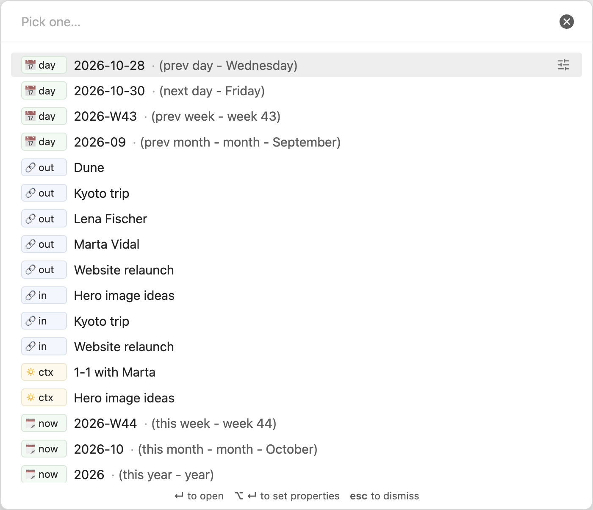
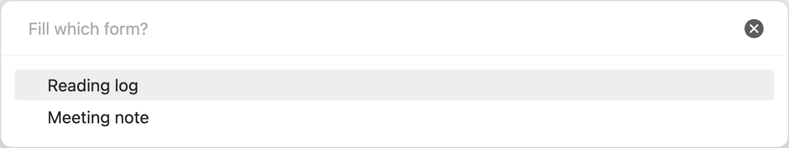

# Note Compass

**English** · [Español](README.es.md) · [简体中文](README.zh-CN.md) · [繁體中文](README.zh-TW.md) · [日本語](README.ja.md) · [한국어](README.ko.md)

Move between related notes, set properties, fill in forms and process tasks, all from keyboard pickers that work anywhere in Obsidian.



## What it does

Note Compass adds keyboard pickers for navigation, properties, forms and your own task commands. Type a few letters and press Enter to choose.

### Jump to note

Move to the notes related to the note in focus, or to any list you define. Group your lists into named navigation pickers, each with its own command.


- See the adjacent date notes, outbound links, inbound links and notes from the same day in one list.
- Add your own lists with filters on properties, folders, tags, links and dates.
- Edit a row's properties without opening the note.

[Read more about Jump to note](docs/jump-to-note.md)

### Set properties

Edit the properties of the note in focus from one picker, and save every change at once.


- Pick links to people, projects or any notes you choose, and set checkboxes, text, numbers and dates.
- Offer preset values and the values your vault already uses.
- Set several properties with one choice, such as marking a note done and archived.
- Nothing is written until you choose "Save & close".

[Read more about Set properties](docs/set-properties.md)

### Fill form

Answer a few questions and get one new note with its name, text and properties filled in.



- Build forms such as a reading log or a meeting note, with fixed values and asked questions.
- Each form is also a command, so you can give it a hotkey.
- Review every answer before the note is created.

[Read more about forms](docs/forms.md)

### Process tasks

Complete, cancel, migrate or schedule tasks in the active note from a command you define.


- Choose which task statuses to list or skip.
- Change status, add a completion date, or copy tasks to periodic or specific notes.
- Stage a batch and finish when ready, or cancel without writing.

[Read more about Task commands](docs/task-commands.md)

## Installation

Once Note Compass is listed in the community plugins browser, open Settings → Community plugins → Browse, search for "Note Compass", then install and enable it.

To install it by hand:

1. Download `main.js`, `manifest.json` and `styles.css` from the latest release:
   https://github.com/carlesba/obsidian-note-compass/releases/latest
2. Put the three files in `<vault>/.obsidian/plugins/note-compass/`.
3. Reload Obsidian and enable Note Compass under Settings → Community plugins.

Note Compass needs Obsidian 1.13.0 or later and runs on both desktop and mobile.

## Quick start

1. Open Settings → Hotkeys, search for "Note Compass", and assign keys to "Navigation: Default", "Set properties" and "Fill form". "Jump to note" lists every navigation picker you create. You can also run them from the command palette.
2. Open today's daily note and press the "Navigation: Default" hotkey to move to yesterday's note or to a note you linked from it.
3. On a note you are working on, press the "Set properties" hotkey, type a few letters of a person's name, pick them, and choose "Save & close".
4. Open Settings → Note Compass to switch off what you do not use, point the link properties at your own folders and notes, and add a form for the notes you create often, such as people.
5. Add a command in Settings → Note Compass → Tasks, open a note with unchecked tasks, and run "Process open tasks". Enter stages completion; `🏁 Finish processing` saves.

The defaults give you the four relation lists in the "Default" navigation picker and a set of common checkbox and link properties in "Set properties".

## Manual

- [Jump to note](docs/jump-to-note.md): lists, relation lists, date notes and filtering.
- [Set properties](docs/set-properties.md): picker rows, value pickers, presets and checkboxes.
- [Forms](docs/forms.md): running a form, form settings, fields and placeholders.
- [Task commands](docs/task-commands.md): status filters, actions, destinations and batch processing.
- [Settings](docs/settings.md): the main page and its Navigation, Properties, Forms and Tasks pages, rows, prefixes, list filters and property pages.
- [Tips and known behaviour](docs/tips.md)
- [Development](docs/development.md)

## Languages

Note Compass follows the language you choose for Obsidian: English, Spanish, Simplified Chinese, Traditional Chinese, Japanese or Korean, and English for any other. The translated readmes are linked at the top, and this English manual is the reference.

## Development

```bash
npm ci
npm run dev
npm run build
npm test
npm run lint
```

See [Development](docs/development.md) for what each command does and how to try the plugin in a test vault.

## License

MIT, see [LICENSE](LICENSE).
