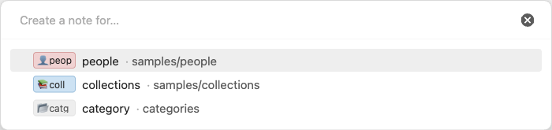
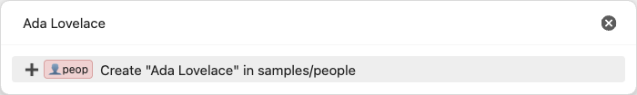
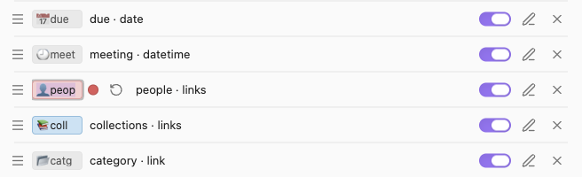

# Note Compass

Note Compass adds three commands that work from anywhere in Obsidian, with or without an editor open. "Jump to note" opens one picker with the notes related to the note in focus, such as its adjacent date notes and the notes it links to, alongside lists you define by property, folder or link. "Set properties" edits the properties of the note in focus from a single picker. "Create note" makes a new note that already belongs to one of your link properties, so the other two commands offer it from then on.


## Installation

Once Note Compass is listed in the community plugins browser, open Settings → Community plugins → Browse, search for "Note Compass", then install and enable it.

To install it by hand, download `main.js`, `manifest.json` and `styles.css` from the latest release on GitHub:

https://github.com/carlesba/obsidian-note-compass/releases/latest

Put the three files in `<vault>/.obsidian/plugins/note-compass/`, reload Obsidian, and enable Note Compass under Settings → Community plugins.

Note Compass needs Obsidian 1.13.0 or later and runs on both desktop and mobile.

## Quick start

The commands are meant to be used from the keyboard, so give each one a hotkey first. Open Settings → Hotkeys, search for "Note Compass", and assign keys to "Jump to note", "Set properties" and "Create note". You can also run them from the command palette.

A typical flow looks like this. Open today's daily note and press the "Jump to note" hotkey to move to yesterday's note or to a note you linked from it. On a note you are working on, press the "Set properties" hotkey, type a few letters of a person's name, pick them, and choose "Save & close". When the person does not exist yet, press the "Create note" hotkey, choose the people property, type the name, and the new note is ready to be linked.

The defaults give you the four relation lists in "Jump to note" and a set of common checkbox and link properties in "Set properties". Open Settings → Note Compass to switch off what you do not use and to point the link properties at your own folders and notes.

## Jump to note

"Jump to note" opens a picker of notes to move to. Picking a row opens the note in the active tab, or in a new tab when none is open.


The picker shows the lists you set up under "Jump to note" in settings, in the order you set. Four of the available lists depend on the markdown note in focus, and they are left out when anything else has focus or no tab is open:

- Adjacent dates lists the previous and next note of the same period when the note in focus is a date note, as in `📅 day 2024-03-06 (next day - Wednesday)` or `📅 day 2024-W09 (prev week - week 9)`.
- Outbound links lists the notes the note in focus links to, links in properties included.
- Inbound links lists the notes that link to the note in focus.
- Same day lists the notes created on the same day as the note in focus. For a day note it uses the date in its name rather than when the file was created.

The other lists do not depend on the note in focus:

- Notes with a property lists the notes whose property meets a condition, such as `status is active` or `project has item Website`.
- Links to note lists the notes that link to a chosen note, in their text or in a property.
- In folder lists the notes in a folder and its subfolders.
- Modified today lists the notes changed since midnight.

Each note appears once, under the first list that holds it, and the note in focus is left out. Within a list the notes are sorted by name. When no list has any note, the command says "No notes to jump to." instead of opening an empty picker.

Every row starts with its list's prefix, shown as a small chip so it stays apart from the name. All chips in a picker share the width of the widest one, up to about twelve characters, so the names line up, and a list with a prefix colour tints its chips. A date note adds its period after the name: the weekday for a day note, `week N` for a week note, `month - <Month>` for a month note and `year` for a year note.

Typing filters the rows by in-order matching. A row stays when the characters you typed appear in it in the same order, ignoring case, with anything in between. The prefix is part of the row, so typing part of a prefix narrows the picker to that list.

### Date notes

A note is a date note when it sits directly in the folder set for its period and its name matches that period's format exactly. There are five periods, day, week, month, quarter and year, and each has its own folder, format and on/off switch.

The "Read from" setting under "Date notes" chooses where those formats come from. "Automatic" uses the Periodic Notes plugin when it is enabled, then the core Daily notes plugin, then the plugin's own Custom formats. Daily notes covers days only, so the other periods come from Custom. Whenever a period comes from Custom, a pencil next to "Read from" opens its formats, where you set each period's folder and its format as a Moment format:

https://momentjs.com/docs/#/displaying/format/

By default every period lives in `on/`, as `2024-03-05`, `2024-W10`, `2024-03` and `2024`, with quarters such as `2024-Q1` switched off.

## Set properties

"Set properties" edits the properties of the markdown note in focus from one picker. It only appears in the command palette when a markdown note has focus.

Nothing is written while you work in the picker. The first two rows are always `🏁 Save & close`, which writes only the properties you changed, and `🛑 Cancel`, which discards every change. Escape does the same as Cancel.

Next come the values the note will be saved with, each marked `✓`: one row per linked note, and one row for each checkbox, text, number or date with its value beside it. A value you changed in this session is also marked `•`. Choosing a set link or text removes it, so a links property loses that one note. Choosing a set checkbox, number or date opens its own picker.

Below the set values, each enabled property offers what it can add, in the order of your settings:

- A link or links property lists the notes from its source that are not set yet, most recently modified first. Choosing one adds it to a links property, or replaces the note a link property holds. Links are saved as a list such as `["[[Alice]]", "[[Bob]]"]`, and links the property already holds that its source does not offer are kept.
- A text property lists the values it already has across the vault, most used first, and choosing one replaces the value. When nothing matches what you typed, it also offers `✏️ <property>: use "<what you typed>"`.
- A checkbox, number, date or datetime property that is not set shows one row with its name, which opens its own picker.

With nothing typed, each property shows at most five values, followed by `… N more, type to filter`, which types the property's prefix for you. Once you type, every matching row is shown. After you choose a value the picker reopens with what you typed, so the value you just chose shows up at the top as set and you can keep going.


A property's own picker marks its current value `✓` and ends with `🗑️ Clear`, which removes the property. Escape returns to the main picker without changing that property, and the changes you already made there are kept.

- A checkbox offers `true` and `false`.
- A number offers `✏️ Use "<what you typed>"` for a number, then the numbers the property already has in the vault, most used first.
- A date offers "Use" for a date typed as `YYYYMMDD` or `YYYY-MM-DD`, then Today, Tomorrow, Next Monday and In a week, and is saved as `YYYY-MM-DD`.
- A datetime offers "Use" for `YYYYMMDD HHmm`, `YYYY-MM-DD HH:mm` or `YYYY-MM-DDTHH:mm`, then Now, and is saved as `YYYY-MM-DDTHH:mm`.


Link properties never offer the note in focus, notes in the property's excluded folders, or notes with `archived: true`. The picker only links notes that already exist, so to link a new note, make it first with "Create note".

## Create note

"Create note" makes a new note that belongs to one of your link properties, so that property offers it from then on. It works with or without a note in focus, and it neither opens the new note nor links it from the note in focus.

It works in two steps. The first picker, "Create a note for…", has one row per enabled link or links property that has "Allow creating notes" switched on, with the folder the note will go to beside it, or `vault root`.



Choosing a row opens the second prompt, where you type the name of the new note. A usable name shows a single row, `➕ Create "<name>" in <folder>`, and choosing it creates the note and says where, as in `Created "Ada Lovelace" in samples/people.` Escape goes back to the first step.



A name with characters Obsidian cannot use in a file name is refused with a message saying so. A name that any note in the vault already has, in any folder and ignoring case, is refused too, as in `"Ann" already exists at people/Ann.md.`, because a second note with that name would make `[[Ann]]` links ambiguous. Choosing one of these rows keeps the prompt open with what you typed.

The new note goes in the source's folder when the property offers notes from a folder. Otherwise it goes in the property's "Folder" under "Create notes", and when that is empty, where Obsidian puts new notes.

When the property has a "Template", the note starts from it. If the Templater plugin is enabled, Templater creates the note, so its `<% %>` commands run; if Templater fails, nothing more is done. Without Templater, the template's content is copied, `{{title}}` becomes the note's name, and `{{date}}` and `{{time}}` become the current date and time in the formats set in the core Templates plugin, `YYYY-MM-DD` and `HH:mm` by default. `{{date:FORMAT}}` and `{{time:FORMAT}}` use the format given.

Finally, the note joins the property's source, so it shows up in that property's list straight away. For a "Links to note" source, a link to that note is added at the end of the body unless the content already links there. For a property condition, the note gets the property the condition asks for, such as `true` for "is true", the value for "is", or a list with the value for "has item".

Only sources that can hold a new note qualify: notes in a folder, notes linking to a note, notes modified today, and property conditions that give a value to write, such as "is true", "is", "has item", or "is set" on a checkbox. The relation sources and conditions such as "greater than" cannot, and the "Allow creating notes" switch explains why when it is disabled. When no property qualifies, the command says "No link property can create notes."

## Settings

Settings fit a narrow window and work the same on mobile. They are split into four parts: "Display", the "Jump to note" lists, "Date notes" and the "Set properties" list.


### Display

"Show prefixes" is on by default. Turning it off removes the prefix from every row in all three pickers and leaves it out of what typing matches. Link rows in "Set properties" then show the property they write instead, as in `✓ Marta Vidal · people`. The settings hide the prefix chips and the prefix fields too, but your prefixes and colours stay saved, so turning the setting back on restores them.

### Lists and properties

"Jump to note" and "Set properties" are both lists of rows, and their rows work the same way. Each row shows its prefix chip and what it lists or writes, such as `status is active` or `people · links`.

- Drag the handle on the left to reorder the rows. The order is the order of the picker.
- Use the switch to show or hide a row in the picker without losing its setup.
- Use the pencil to open the row's page, and the cross to delete it.
- Use the `+` in the section header to add a row. A new row starts switched off, so it stays out of the picker until you fill it in and switch it on.

To edit a prefix, click its chip, or focus it and press Enter. A colour swatch and a reset button appear beside the text, and the chip previews the colour as you pick it. Enter or clicking away saves both the text and the colour, and Escape leaves both unchanged. An empty prefix shows as a faint `prefix` chip.



### List pages

A list's page has "Enabled", "Prefix", "Prefix colour" and "Remove prefix colour", then "Source", which chooses what the list holds: adjacent dates, outbound links, inbound links, same day, notes with a property, notes linking to a note, notes in a folder, or notes modified today.

A property list asks for the property, suggesting the vault's properties with their types, then a condition offered for that type:

- Checkbox properties can be true, false, set or not set. "Is false" needs an explicit `false`.
- Text properties can be equal to a value, contain it, be set or not set.
- List, tag and alias properties can have an item equal to the value, be set or not set. Wiki-links are compared by their link text, so `[[Project]]` matches the value `Project`.
- Number properties can be equal to, less than or greater than a number, or be set.
- Date properties can be on, before or after a fixed date, today, or a number of days ago or from now, or be set. A relative date is worked out each time the picker opens.

"Is not set" also matches a property left blank.

### Property pages

A property's page has "Enabled", "Prefix" and "Prefix colour" as on a list's page, then "Property" and "Type". "Property" suggests the vault's properties with their types, and picking one sets the type to match: checkbox, number, date and datetime keep theirs, lists and tags become links, and anything else becomes text. "Type" can be checkbox, text, number, date, datetime, link for one note, or links for several, and stays disabled until a property is chosen.


A link or links property has three more sections:

- "Offer notes from" chooses the notes the picker offers, with the same sources as a jump list.
- "Excluded folders" lists folders whose notes are never offered. The `+` in its header adds a folder, each row can be deleted, and an empty row excludes nothing.
- "Create notes" decides whether the property appears in "Create note". "Allow creating notes" switches it on, "Folder" sets where new notes go, and "Template" sets the note new notes start from.

Several rows may write the same property, such as the default `related` rows with different sources. They share one value, and the first enabled row decides its type. A row warns you when two rows for one property disagree on type.

## Tips

- Give the three commands hotkeys you can press without looking. The plugin is built around opening a picker, typing a few letters and pressing Enter.
- Keep prefixes short, such as an emoji and a three or four letter tag like `👤 peop` or `📅 due`. All chips share the width of the widest one, so one long prefix pushes every name to the right.
- Use colours to group related lists, such as one colour for all your people and company lists and another for project lists, so you can tell them apart at a glance.
- Type a prefix tag to narrow a picker towards one list, such as `peop` for the people rows in "Set properties".
- Use a "Links to note" source as a lightweight tag. Create a note such as `Person` and point the people property at "Links to note: Person". Every note created through "Create note" for that property gets a link to `Person`, so it shows up in the list without you tagging it by hand.
- Add your templates folder to "Excluded folders" on every link property, so template notes are never offered as values.
- Turn "Show prefixes" off for a minimal look once you know your lists. Link rows then name their property instead.
- In "Set properties", Escape in a value picker only steps back to the main picker. The changes you already made are kept until you choose "Save & close" or "Cancel".

## Known behaviour

- A day format containing `/`, such as `YYYY/MM/DD`, never matches, because a note's name is compared without its folders.
- With the default formats, notes named after a year in the date notes folder, such as `on/2024`, count as year notes. Switch the year period off in the Custom formats if you keep other notes named that way in that folder.
- If a property changes type, a list filtering on it keeps its old condition and shows nothing until you pick a new one. Its row and page say that the condition no longer applies.
- "Create note" never touches an existing note. If a note already exists at the path it would create, it is left alone and the command says so.

## Development

```bash
npm ci
npm run dev
npm run build
npm test
npm run lint
```

`npm run dev` rebuilds on every change, `npm run build` typechecks and writes the production bundle, `npm test` runs the unit tests, and `npm run lint` runs the same Obsidian lint rules the community review applies.

To try the plugin in a test vault, symlink the repository into its plugins folder, so the vault always loads the build `npm run dev` just wrote:

```bash
ln -s "$PWD" "<vault>/.obsidian/plugins/note-compass"
```

## License

MIT, see [LICENSE](LICENSE).
