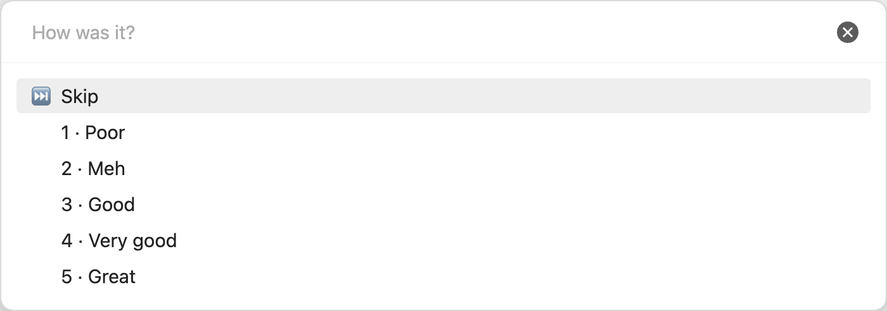
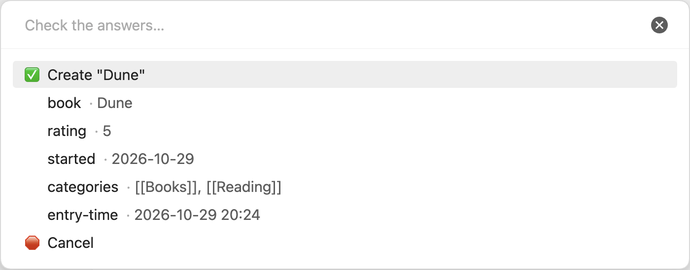
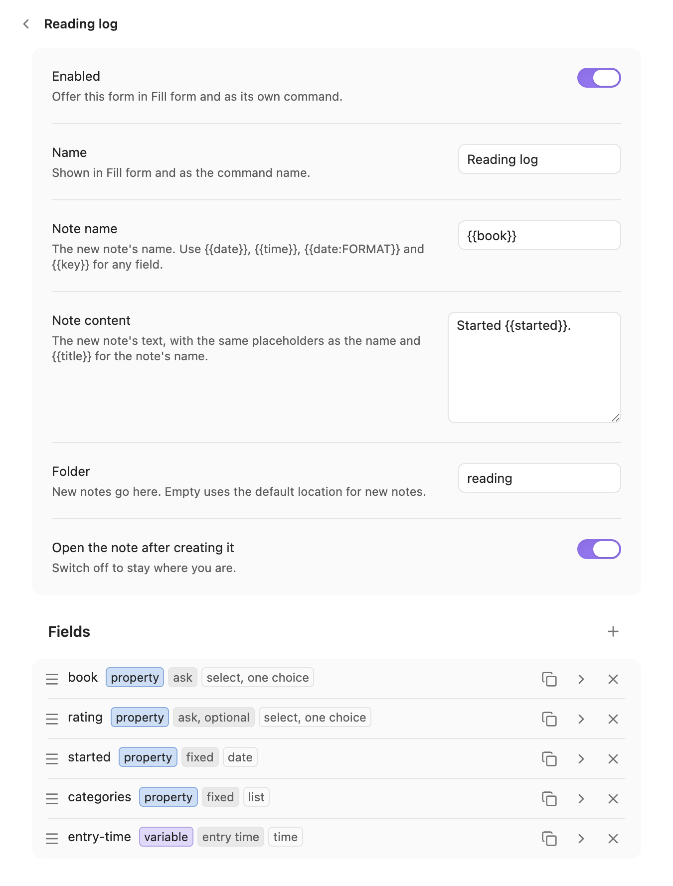
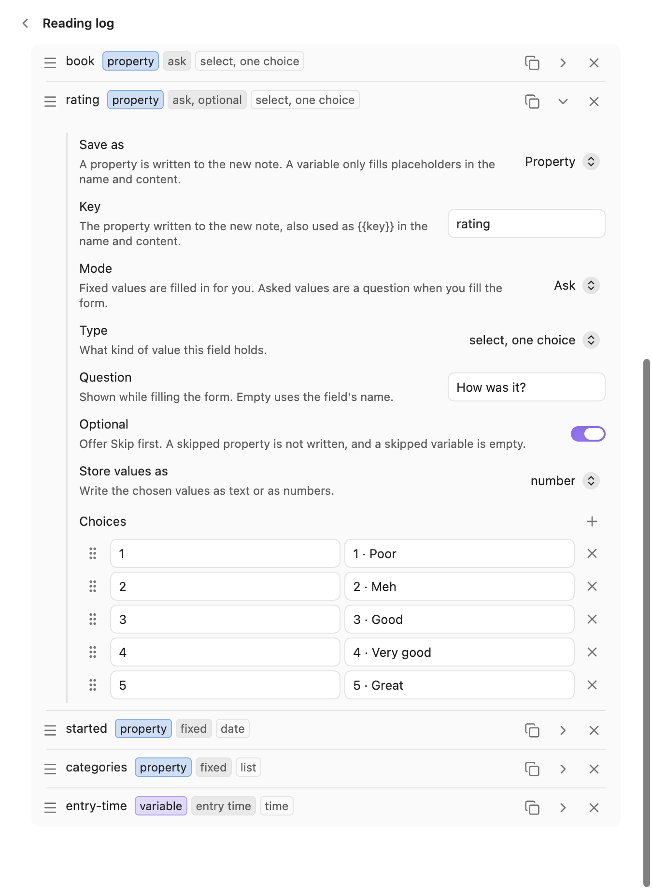
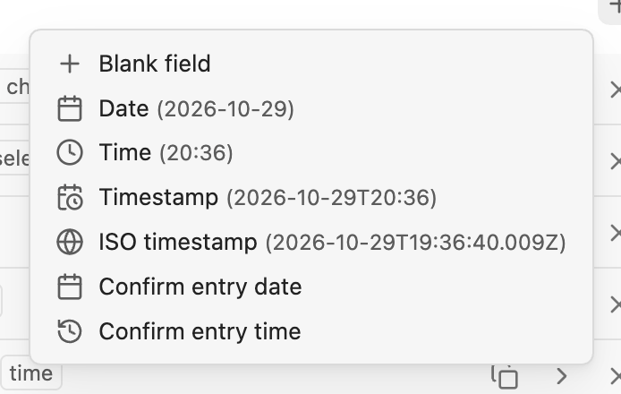
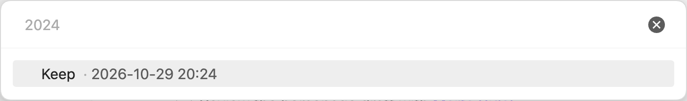

# Forms

A form asks a few questions and creates one new note from the answers, with its name, text and properties filled in.

[← Back to the README](../README.md)

## What a form is

A form turns a note you make often into a few questions, such as a reading log entry that asks for the book and a rating, or a meeting note that asks for the people. You define forms in Settings → Note Compass → Forms. Each form has a pattern for the note's name, the note's text, a folder, and a list of fields that are either fixed values or questions.

## Fill form and per-form commands

There are two ways to run a form, both working with or without a note in focus.

- "Fill form" lists your enabled forms under "Fill which form?" and runs the one you choose.
- Each enabled form is also a command of its own, named after the form, so you can give it a hotkey.

When there are no forms, "Fill form" says "No forms yet. Add one in Settings → Note Compass → Forms."

## Running a form

Running a form takes you through its questions, then a summary where you check the answers and create the note.

1. Answer each question. A form asks one question per asked field, in the order of its "Fields" list.
2. Review the summary, "Check the answers…", that opens after the last question.
3. Choose `✅ Create "<name>"`.

### Moving around

| Key or row | Does |
| --- | --- |
| Enter | Answers the question with the highlighted row. |
| `⏭️ Skip` | Skips an optional question. A skipped property is not written at all, and a skipped variable is empty. |
| Escape | Goes back to the previous question. On the first question it closes the form without making a note. |
| ⌘↵, or Ctrl+Enter on Windows and Linux | Creates the note from any question once every required question has an answer. |

The answers you already gave are kept when you go back, and show a check.

### The summary

The summary shows what the note will get before anything is written.

- The first row is `✅ Create "<name>"`, with the note's name worked out from your answers.
- Then one row per field with the value it will get, or `skipped`.
- The last row is `🛑 Cancel`.
- Choosing an asked field opens its question again, and comes back to the summary after you answer it.
- Escape goes back to the last question, or closes the form when it asks no questions.

### Creating the note

When you choose `✅ Create "<name>"`, Note Compass writes the note and tells you where it went.

1. The note goes in the form's "Folder", or where Obsidian puts new notes when that is empty.
2. When a note with that name already exists there, ignoring case, the new one gets a number, as in `Dune 2`.
3. The note's text is written first, then its properties in the order of the fields.
4. Note Compass says where the note went, as in `Created "Dune" in reading.`, and opens it unless "Open the note after creating it" is off.

## Form page

A form's page, under Settings → Note Compass → Forms, holds everything the form needs.

| Setting | What it is |
| --- | --- |
| Enabled | Offers the form in "Fill form" and as a command. |
| Name | Shown in "Fill form" and as the command name. |
| Note name | The pattern for the new note's name, such as `{{date:YYMMDDHHmm}} {{book}}`. |
| Note content | The new note's text, with the same [placeholders](#placeholders). |
| Folder | Where new notes go. |
| Open the note after creating it | On by default. Switch it off to stay where you are. |
| Fields | The values the form fills in or asks for. Their order is the order of the questions. |

In the note name, spaces repeated by an empty placeholder are collapsed. A name that ends up empty, or with characters Obsidian cannot use in a file name, is refused with a message, keeping you on the summary.

### The fields list

The fields list works like the other lists in the settings.

- Drag the handle to reorder the fields.
- The copy icon duplicates a field right below it.
- The cross deletes a field.
- The `+` in the header opens a menu to add one, described under [Adding fields](#adding-fields).

Each row shows the field's key, followed by small badges for where it is saved, its mode and its type, as in `book` `variable` `ask` `text`. Property badges are blue and variable badges are purple. The mode badge reads `fixed`, `ask`, `ask, optional` or `entry time`.

Click the row or its chevron to edit the field right below it, and click again to close it. One field is open at a time, and a new field opens straight away.

### Adding fields

The `+` in the "Fields" header offers a blank field and ready-made presets.

| Menu item | Adds |
| --- | --- |
| Blank field | An empty asked text field. |
| Date | A fixed field set at creation, keyed `date`, formatted `YYYY-MM-DD`. |
| Time | A fixed field set at creation, keyed `time`, formatted `HH:mm`. |
| Timestamp | A fixed field set at creation, keyed `timestamp`, formatted `YYYY-MM-DDTHH:mm`. |
| ISO timestamp | A fixed field set at creation, keyed `iso-timestamp`, formatted as ISO 8601. |
| Entry time (confirm or change) | An asked time variable called `entry-time` with "Use as the entry time" switched on, so the note keeps today's date and you confirm or change the time. See [Entry time](#entry-time). |

Each item shows what it would write right now. A key already in use gets a number, as in `timestamp-2`.

## Fields

Every field is a fixed value the form fills in, or a question it asks.

| Setting | Options |
| --- | --- |
| Save as | "Property", the default, writes the value to the new note's properties under its key. "Variable" only fills placeholders in the name and content and is never written. |
| Key | The property name or the variable's name, used as `{{key}}` in both cases. |
| Mode | "Fixed" for a value filled in for you, or "Ask" for a question. |
| Type | What kind of value the field holds, listed below. |

### Fixed values

A fixed field writes the same value every time the form runs, or a date worked out when it runs.

| Type | Value |
| --- | --- |
| Text | Any text. Typing `[[` suggests the vault's notes. |
| Number | Only keeps numbers. |
| Checkbox | A switch. |
| List | A box where each item shows as a chip. Type an item and press Enter to add it, and use its × to remove it. |
| Date, time, datetime | See [Dates and times](#dates-and-times). |

List items may be links, so `[[Books]]` and `[[Reading]]` write `categories: ["[[Books]]", "[[Reading]]"]`. This is how a form links its notes to other notes. In a fixed text value or the list's box, typing `[[` suggests the vault's notes, and picking one writes its link, such as `[[Books]]`, using the folder only when two notes share the name. In the list's box the picked link becomes a chip straight away.

### Asked questions

An asked field becomes one question when the form runs.

| Setting | What it does |
| --- | --- |
| Question | The prompt. When empty, the field's key is used. |
| Optional | Puts `⏭️ Skip` first in the question. A skipped property is not written at all, and a skipped variable is empty. |

| Type | The question |
| --- | --- |
| Text, number | Takes anything you type. A text or number property also offers the values the property already has in the vault. |
| Checkbox | `true` or `false`. |
| Select | One of its choices. |
| Multiselect | Several of its choices, each marked with a check once picked. Finish with `🏁 Done`. |
| Date, time, datetime | See [Dates and times](#dates-and-times). |

### Choices

Select and multiselect fields offer a list of "Choices", each with a value and an optional label.

- The `+` in the "Choices" header adds one, the cross removes one, and dragging a choice's handle reorders it.
- The question shows the label, or the value when there is none, and the note gets the value.
- "Store values as" writes the values as text or as numbers. A choice with the value `4` and the label `4 · Great` can write the number 4.

### Dates and times

Date, time and datetime fields write a moment in the format you choose.

| Format | Example |
| --- | --- |
| `YYYY-MM-DD` | `2028-10-30` |
| `HH:mm` | `09:00` |
| `YYYY-MM-DDTHH:mm` | `2028-10-30T09:00` |
| ISO 8601 | `2028-10-30T08:00:00.000Z`, in UTC |
| Custom | Any Moment.js format, such as `dddd`. |

A fixed one takes its "Value" from one of these:

| Value | Writes |
| --- | --- |
| At creation | The time the form started. |
| On a set date | A date you type below it. |
| From field … | The value of another date or time field of the form. When that field is skipped, this one is skipped too. |

A set date is typed as digits, `YYYYMMDD` for a date, `HHmm` for a time and `YYYYMMDDHHmm` for a datetime, or with dashes and colons. The line under it shows how it was read, such as `✓ Mon 30 Oct 2028, 09:00`.

"From field" lets one asked time feed several properties, such as a `day` with `YYYY-MM-DD` and a `timestamp` with ISO 8601.

An asked one offers "Now", and a date also offers "Today", "Tomorrow", "Next Monday" and "In a week". You can also type `20240311`, `2024-03-11`, `0930`, `09:30`, `202403110930` or `20240311 0930`, as in the date pickers of "Set properties". A time is that time today.

### Entry time

The entry time lets you confirm or change when the note is for, such as a meeting you log an hour later. Switch on "Use as the entry time" on an asked date, time or datetime field, or add the "Entry time (confirm or change)" preset.

1. The question's placeholder is the time the form started, in digits, such as `0930` for a time field or `202810300900` for a datetime.
2. Its first row is "Keep", so Enter accepts that time.
3. To change it, type another one in the same digits. A datetime field also takes a bare `0930` as today at 09:30.

The answer then replaces the form's time everywhere it is used: `{{date}}` and `{{time}}` in the name and content, and every fixed field set "At creation". Only one field of a form can be the entry time, and a second one shows a warning.

### Details

Warnings and unreadable forms

- A field without a key, two fields with the same key, a select without choices, or a date taken from a field that is not a date warn on the field's row and on the form.
- A form this version of Note Compass cannot read stays in the list switched off, with a warning and no pencil, like an unreadable list. Its saved setup is kept until you delete it.
- A duplicated form is named `<name> copy`.

## Placeholders

Placeholders fill a form's note name and note content with its answers and the time.

| Placeholder | Becomes |
| --- | --- |
| `{{date}}`, `{{time}}` | The time the form started, or the entry time, in the formats set in the core Templates plugin. |
| `{{date:FORMAT}}`, `{{time:FORMAT}}` | The same time in the format given. |
| `{{key}}` | The value of the field called `key`. Lists are joined with commas, and a skipped field is empty. |
| `{{key:FORMAT}}` | A date or time field in the format given, such as `{{started:dddd}}`. |
| `{{title}}` | The new note's name. In the content only. |

Any other placeholder is left as it is.

## Example

A "Reading log" form could have these fields:

| Key | Save as | Mode | Type | Value |
| --- | --- | --- | --- | --- |
| `book` | property | ask | select | The books Dune, The Hobbit and Middlemarch. |
| `rating` | property | ask | select | Choices `1` to `5` with labels such as `5 · Great`, stored as numbers. |
| `started` | property | fixed | date | At creation. |
| `categories` | property | fixed | list | `[[Books]]`, `[[Reading]]`. |
| `entry-time` | variable | ask | time | Use as the entry time. |

With the note name `{{date:YYMMDDHHmm}} {{book}}`, each run asks for the book, the rating and the time, and creates a note such as `2810300930 Dune` linked to `[[Books]]` and `[[Reading]]`.
