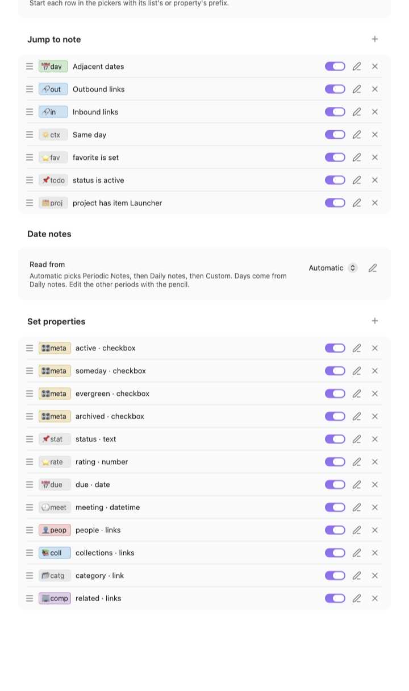
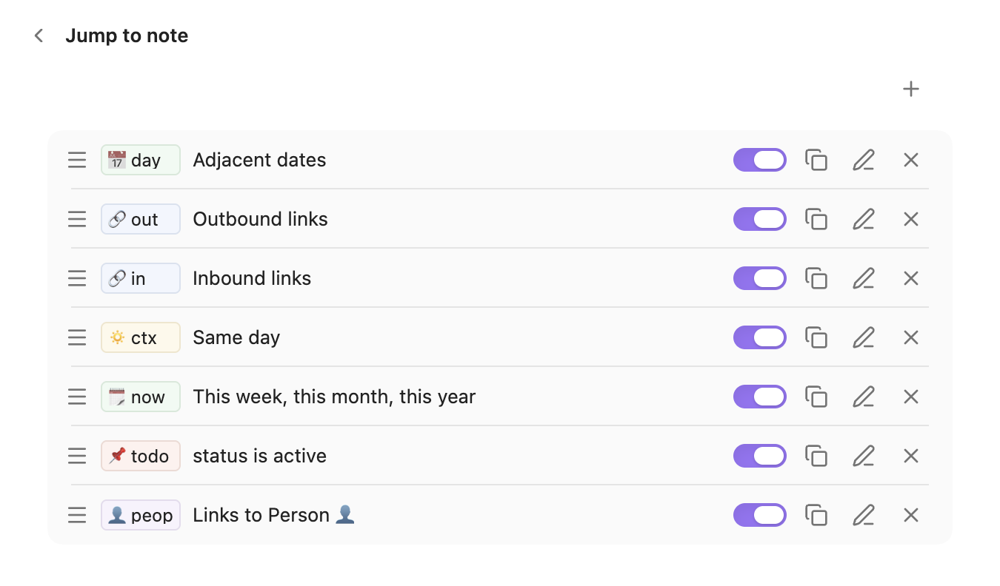
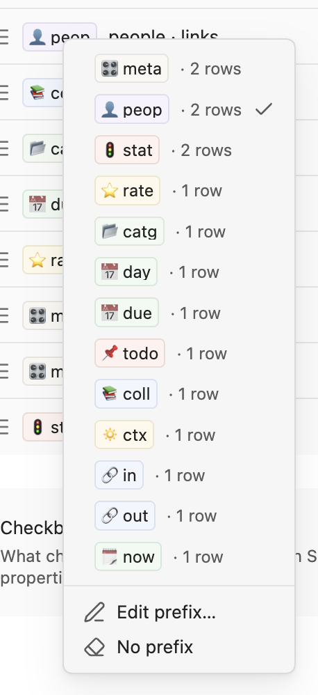
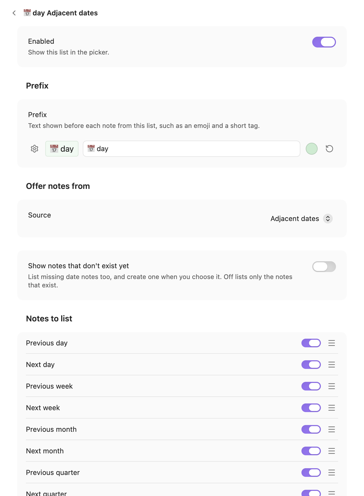
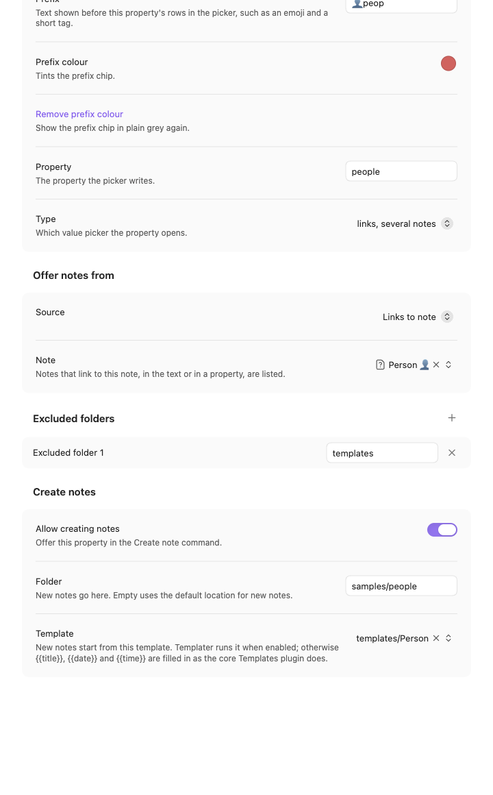

# Settings

Settings → Note Compass decides what each picker offers, how its rows look, and which forms and task commands exist.

[← Back to the README](../README.md)

## Overview

The main page opens with a short note on what each of its four pages holds, then the four pages, an "Integrations" group with "Date notes source", and "Reset all settings" at the bottom. It fits a narrow window and works the same on mobile.

| Item | What it holds |
| --- | --- |
| Navigation | Your [navigation pickers](navigation.md#navigation-pickers), each offered in the command palette as "Navigation: <name>". |
| Properties | The properties of the [Set properties](set-properties.md) picker, and "Checkbox behaviour". |
| Forms | Your [forms](forms.md) and [custom fields](forms.md#custom-fields). |
| Tasks | Your [task commands](task-commands.md), each offered under its name in the command palette. |
| Integrations → Date notes source | Where date note formats come from, described in [Date notes](navigation.md#date-notes). The pencil edits the custom formats. |

Click anywhere on one of the four rows to open its page, and use the back arrow at the top to return. A row's own page opens inside its section, so going back from a list's page lands on its navigation picker's page, and going back again lands on the Navigation page.

## Navigation pickers

The Navigation page lists your navigation pickers with the same add, reorder, switch, edit, copy and delete controls as the other settings lists. A new picker starts with no lists and an empty filter, and the copy icon duplicates a picker with its filter and all its lists.

| Section | Setting | What it does |
| --- | --- | --- |
| Navigation picker | Enabled, Name, Placeholder | Offers the picker as "Navigation: <name>" in the command palette and in "Select navigation picker". The placeholder is the text in the picker's search box, and it shows the name when left empty. |
| Filter | Main filter | The picker's main [filter](#filters). Every note must match it to show in this picker, on top of each list's own source and filter. Empty by default, so it hides nothing. |
| Lists | List rows | Each list picks the notes of one source, such as a folder, the notes that link to a note, or a filter, and shows them with its own prefix. The picker shows every enabled list in order, so a note can appear under more than one list. See [Lists and property rows](#lists-and-property-rows) and [List pages](#list-pages). |

Below the pickers, "Insert links while typing" switches on the link list described in [Inserting links while typing](navigation.md#inserting-links-while-typing), with its "Trigger" and the "Navigation picker" it uses. When that picker is off or removed, or the trigger is empty, the picker setting shows a warning and typing the trigger does nothing.

## Forms and Tasks

These pages use the same add, reorder, switch, edit, copy and delete controls as the other settings lists. Each row shows only its name; a second line appears only for warnings, not a configuration summary.

- The Forms page lists your forms and, below them, your [custom fields](forms.md#custom-fields), the field templates offered when adding a field to any form.
- A form’s page defines its note and questions: see [Forms](forms.md#form-page).
- A task command’s page sets Command, Tasks to list, Tasks to skip, Options and Actions: see [Task commands](task-commands.md#command-page).
- New task commands start with Bullet Journal actions; no task commands exist until you add one.

## Lists and property rows

A navigation picker's page and the Properties page are both lists of rows, and their rows work the same way. Each row shows its prefix chip and what it lists or writes, such as `status is active` or `people · links`.

| Control | Does |
| --- | --- |
| Drag handle, on the left | Reorders the rows. The order is the order of the picker. |
| Switch | Shows or hides the row in the picker without losing its setup. |
| Pencil | Opens the row's page. |
| Copy icon | Duplicates the row. The copy lands right below it with the same setup, and a form's copy is named `<name> copy`. |
| Cross | Deletes the row. |
| `+` above the list | Adds a row. Its page opens straight away so you can fill it in, and the new row starts switched on. |

Rows that cannot be read

A row this version of Note Compass cannot read, such as one saved by a newer version, stays in the list with a warning: "This list can't be read by this version of Note Compass. Remove it and build a new one." Its switch is off and disabled and it has no pencil, so it never adds notes to a picker. Its saved setup is kept as it was until you delete it.

## Prefixes

A prefix is the short chip at the start of a row, such as `👤 peop` or `📅 due`, which tells you which list a row comes from. Rows share a prefix when its text and its colour are the same, so `👤 peop` in red and `👤 peop` with no colour are two prefixes.

### The prefix menu

The prefix menu reuses a prefix you already have on another row.

1. Click a prefix chip, tap it, or focus it and press Enter. A phone shows the menu as a sheet from the bottom.
2. The menu lists every prefix in use across every navigation picker and the Properties page, each as its chip followed by how many rows use it, such as a `📅 due` chip with `· 3 rows`, most used first. The row's own prefix is ticked.
3. Pick one to give this row its text and its colour. No other row changes.

| Menu item | Does |
| --- | --- |
| A prefix | Gives this row that text and colour. |
| Edit prefix… | Opens the row's page with the cursor in "Prefix". |
| No prefix | Shown when the row has one. Clears its text and colour. |

An empty prefix shows as a faint `prefix` chip and is never listed.

### The prefix setting on a row's page

On a list's or property's page, "Prefix" shows the settings button, the chip's preview, its text and its colour. What you type and pick changes this row and every row that shared the prefix as the page opened, and the description names those rows, as in "Used by 2 other rows: people · links, Outbound links". They stay together even while the text is briefly empty. The circular arrow removes the colour.

The settings button opens the prefix menu.

| Menu item | Does |
| --- | --- |
| A prefix | Gives this row that text and colour. No other row changes. |
| New prefix… | Shown when the row has a prefix. Empties it, so what you type and pick next changes this row only. |
| No prefix | Shown when the row has one. Clears its text and colour. |

## List pages

A list's page sets what one list in a navigation picker holds.

| Setting | What it is |
| --- | --- |
| Enabled | Shows the list in the picker. |
| Prefix | The chip, described under [Prefixes](#prefixes). |
| Source | What the list holds: adjacent dates, outbound links, inbound links, same day, a filter, notes linking to a note, notes modified today, or current date notes. For the notes in a folder, use a filter with `file in folder`. |

Adjacent dates and Current date notes add two settings below the source.

| Setting | What it does |
| --- | --- |
| Show notes that don't exist yet | Off lists only the date notes that exist. On also lists the missing ones, as in `create next week`, and choosing one creates it. Off by default for adjacent dates, on for current date notes. |
| Notes to list | One row per entry, all switched on by default: "Previous day" and "Next day" through "Previous year" and "Next year" for adjacent dates, "Today" to "This year" for current date notes. Drag a row's handle to change the order the picker shows them in, and switch a row off to leave it out. |

A missing adjacent note is created through Periodic Notes, with its template, when that plugin is the date notes source, and as an empty note otherwise. Each source is described in [Navigation](navigation.md#lists).

A list's row shows the filter's only condition, such as `status is active` or `file has tag project`, or counts its conditions, as in `All of 3 conditions`.

### Filters

A filter lists the notes that match a set of conditions. It offers the same fields, operators and groups as the filters in Obsidian Bases, and looks the same.

1. Choose how the group matches: "All the following are true", "Any of the following are true" or "None of the following are true". A note is listed when it matches every filter in the group, at least one, or none of them.
2. Choose "Add filter" to add a row to the group.
3. Choose what the row tests from its first selector, which lists the file fields below and then the vault's properties, each with its type's icon. Type in its search box to narrow the list, or to use a property no note has yet.
4. Choose the operator from the second selector, which offers only the operators for that field's type, then the value, such as `file in folder projects`, `file backlinks contains Weekly review` or `modified time after 7 days ago`.
5. Choose "Add filter group" to add a group inside it with its own choice.

Groups can sit inside groups up to three levels deep, counting the filter itself. The trash button on a row or on an inner group removes it, and removing the last row of an inner group removes the group too. A new filter has no rows and lists nothing until you add one, and an empty group inside a filter is left out of the matching.

| Field | Holds | Operators |
| --- | --- | --- |
| `file` | The note itself. | is, links to, in folder, has tag, has property, and their negations. |
| `file name`, `file base name` | The note's name without `.md`. | Text operators. |
| `file full name` | The note's name with `.md`. | Text operators. |
| `file path` | The note's path from the vault root, with `.md`. | Text operators. |
| `folder` | The folder the note is in, or `/` at the vault root. | Text operators. |
| `file extension` | `md`. | Text operators. |
| `created time`, `modified time` | The day the note was created or last changed. | Date operators. |
| `file size` | The note's size in bytes. | Number operators. |
| `file links` | The notes this note links to. | List operators. |
| `file backlinks` | The notes that link to this note. | List operators. |
| `file embeds` | The notes and files this note embeds, named by path, or by name for notes. | List operators. |
| `file tags` | The note's tags, from its properties and its text, without `#`. | List operators. |

The operators follow the value's type, in the order Bases offers them:

| Type | Operators |
| --- | --- |
| Text | is, is not, starts with, ends with, is empty, contains, contains any of, contains all of, and the negations. |
| List | is exactly, is not exactly, is empty, contains, contains any of, contains all of, and the negations. |
| Number | =, ≠, <, ≤, >, ≥, is empty, is not empty. |
| Date | on, not on, before, on or before, after, on or after, is empty, is not empty. A date is a fixed day, today, or a number of days ago or from now, worked out each time the picker opens. |
| Checkbox | is, is not, with a checkbox for true or false. |

"Links to note" means `file links to <note>`, and "linked from note" means `file backlinks contains <note>`. For "contains any of" and "contains all of", type the values separated by commas.

Details on matching

- As in Bases, text "contains", "contains any of" and "contains all of" ignore case, while "is", "starts with" and "ends with" respect it.
- List "contains" compares whole items. Wiki-links are compared by their link text, so `[[Project]]` matches the value `Project`, and notes in `file links`, `file backlinks` and `file embeds` can be named by name or path.
- `file has tag` also matches subtags, so `project` matches `#project/website`, and the case and a leading `#` do not matter. `file tags contains` compares whole tags.
- `file in folder` includes the folder's subfolders.
- A row with no value lists nothing, and its negation lists every note.
- "Is empty" also matches a property left blank or missing.
- The negated operators, such as "is not" or "does not contain", match every note the positive operator does not, including notes without the property.

### Property conditions

A property condition asks for the property, suggesting the vault's properties with their types, then offers the operators for that type: text for text, list for list, tags and aliases, number, date for date and datetime, and checkbox.

Filters saved by earlier versions

- Filters saved before the Bases operators open with the matching new operator, and they list the same notes: "is set" becomes "is not empty", "has item" becomes "contains", "is true" becomes "is" with the checkbox ticked, `folder is in` becomes `file in folder`, `tags has tag` becomes `file has tag`, and `links contains` becomes `file links to`.
- File name and path rows now follow the Bases rules above, so "starts with" and "ends with" respect case, and a path includes `.md`. A saved path row that ended with a text gets `.md` added, so it still matches.
- Lists saved by earlier versions as "Notes with a property" open as a filter with that one property condition.
- Lists, property sources, "Notes from" and task sources saved with the "In folder" source open as a filter with the single row `file in folder <folder>`, and they list the same notes.
- If a property changes type, a condition on it keeps its old operator and matches nothing until you pick a new one. The condition, its list's row and its page say that the condition no longer applies.

## Property pages

A property's page sets what one "Set properties" row writes and offers.

| Setting | What it is |
| --- | --- |
| Enabled | Shows the property in the picker. |
| Label | The prefix chip, described under [Prefixes](#prefixes), and in multiple properties mode the row's name. |
| Mode | "Single property", the default, or "Multiple properties", described [below](#multiple-properties). |
| Property | The property written. It suggests the vault's properties with their types. |
| Type | Checkbox, text, number, date, datetime, link for one note, or links for several. Disabled until a property is chosen. |
| Remove when empty | On by default. Removes the property from the note once you clear its value or remove its last link. Switched off, the property stays in the note with an empty value. |

Picking a property sets the type to match: checkbox, number, date and datetime keep theirs, lists and tags become links, and anything else becomes text.

### Preset values

A text or number property has "Preset values", a list of values its own picker offers first, such as `todo`, `doing` and `done` for a `status` property.

- The `+` in its header adds a row with a text field for the value and a switch.
- Rows can be dragged into the order the picker shows them, and each row can be deleted.
- A number property only keeps values written as numbers.
- The switch beside a preset also shows it in the main Set properties menu, so you can keep many presets and put only the few you use most one choice away.
- Every preset is always offered in the property's own picker. After them the picker still offers the other values the property already has in the vault, most used first, and anything you type.

### Link properties

A link or links property has two more sections.

| Section | What it is |
| --- | --- |
| Offer notes from | The notes the picker offers, with the same sources as a jump list. |
| Excluded folders | Folders whose notes are never offered. The `+` in its header adds a folder, each row can be deleted, and an empty row excludes nothing. |

### Multiple properties

A row in "Multiple properties" mode writes several properties at once, with values fixed on its page. The [Set properties picker](set-properties.md#multiple-properties) offers it as one choice. Switching the mode back to "Single property" restores the single property setup, and the fixed values stay saved for the next switch.

| Setting | What it is |
| --- | --- |
| Name | What the picker shows for the row. Empty shows a summary of its values, also used as the field's placeholder. |
| Values to set | One block per property. The `+` in its header adds one, and blocks can be dragged, duplicated and deleted. |

Each block shows its property and value, such as `status done`, `archived ✓` or `active cleared`. Click it to open its editor.

| Field | What it is |
| --- | --- |
| Property | The property written. Focusing it lists the vault's properties, and picking one sets the type to match. A new name works too. |
| Type | Checkbox, text, number, date, datetime, link, links, or "Clear (remove property)". |
| Value | A switch for a checkbox, a text, a number, Today or a fixed date, Now or a fixed date and time, or a note for link and links. Clear has no value. |

A link value replaces the note the property holds, and a links value adds its note to the list. A block with no property or no value is skipped.

### Several rows for one property

Several rows may write the same property, such as the default `related` rows with different sources. They share one value, and the first enabled single property row decides its type. A row warns you when two rows for one property disagree on type.

## Checkbox behaviour

"Checkbox behaviour", below the list on the Properties page, decides what choosing a checkbox in the main Set properties menu does, for every checkbox property. The options are described in [Set properties](set-properties.md#checkbox-behaviour).

## Reset all settings

"Reset all settings", at the bottom of the main page, puts every list, property, form, custom field, task command and option back to the defaults, which have no forms, custom fields or task commands.

1. Choose "Reset all settings".
2. Confirm. Cancel or Escape leaves everything as it was.

The reset cannot be undone.

## Language

Note Compass follows the language you choose for Obsidian. It is available in English, Spanish, Simplified Chinese, Traditional Chinese, Japanese and Korean, and any other language shows English.

Your settings, property names and the values written to your notes stay as you typed them, whatever the language. To help with translations, see [Development](development.md#translations).
