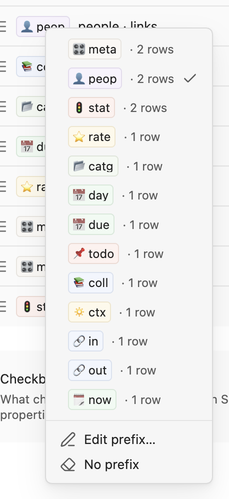

# Settings

Settings → Note Compass decides what each picker offers, how its rows look, and which forms exist.

[← Back to the README](../README.md)

## Overview

The settings are split into five parts, followed by "Reset all settings". They fit a narrow window and work the same on mobile.

| Part | What it holds |
| --- | --- |
| Display | "Show prefixes". |
| Jump to note | The lists of the [Jump to note](jump-to-note.md) picker. |
| Date notes | Where date note formats come from, described in [Date notes](jump-to-note.md#date-notes). |
| Set properties | The properties of the [Set properties](set-properties.md) picker, and "Checkbox behaviour". |
| Forms | Your [forms](forms.md). |

## Display

"Show prefixes" decides whether rows carry their prefix chip. It is on by default.

Turning it off removes the prefix from every row in all three pickers and leaves it out of what typing matches. Link rows in "Set properties" then show the property they write instead, as in `✓ Marta Vidal · people`. The settings hide the prefix chips and the prefix fields too, but your prefixes and colours stay saved, so turning the setting back on restores them.

## Lists and property rows

"Jump to note" and "Set properties" are both lists of rows, and their rows work the same way. Each row shows its prefix chip and what it lists or writes, such as `status is active` or `people · links`.

| Control | Does |
| --- | --- |
| Drag handle, on the left | Reorders the rows. The order is the order of the picker. |
| Switch | Shows or hides the row in the picker without losing its setup. |
| Pencil | Opens the row's page. |
| Copy icon | Duplicates the row. The copy lands right below it with the same setup, and a form's copy is named `<name> copy`. |
| Cross | Deletes the row. |
| `+` in the section header | Adds a row. Its page opens straight away so you can fill it in, and the new row starts switched on. |

Rows that cannot be read

A row this version of Note Compass cannot read, such as one saved by a newer version, stays in the list with a warning: "This list can't be read by this version of Note Compass. Remove it and build a new one." Its switch is off and disabled and it has no pencil, so it never adds notes to a picker. Its saved setup is kept as it was until you delete it.

## Prefixes

A prefix is the short chip at the start of a row, such as `👤 peop` or `📅 due`, which tells you which list a row comes from. Rows share a prefix when its text and its colour are the same, so `👤 peop` in red and `👤 peop` with no colour are two prefixes.

### The prefix menu

The prefix menu reuses a prefix you already have on another row.

1. Click a prefix chip, tap it, or focus it and press Enter. A phone shows the menu as a sheet from the bottom.
2. The menu lists every prefix in use across "Jump to note" and "Set properties", each as its chip followed by how many rows use it, such as a `📅 due` chip with `· 3 rows`, most used first. The row's own prefix is ticked.
3. Pick one to give this row its text and its colour. No other row changes.

| Menu item | Does |
| --- | --- |
| A prefix | Gives this row that text and colour. |
| Edit prefix… | Opens the row's page with the cursor in "Prefix". |
| No prefix | Shown when the row has one. Clears its text and colour. |

An empty prefix shows as a faint `prefix` chip and is never listed.

### The prefix setting on a row's page

On a list's or property's page, "Prefix" shows the settings button, the chip's preview, its text and its colour. What you type and pick changes this row and every row that shared the prefix as the page opened, and the description names those rows, as in "Used by 2 other rows: people · links, Outbound links". They stay together even while the text is briefly empty. The circular arrow removes the colour.

The settings button opens the prefix menu.

| Menu item | Does |
| --- | --- |
| A prefix | Gives this row that text and colour. No other row changes. |
| New prefix… | Shown when the row has a prefix. Empties it, so what you type and pick next changes this row only. |
| No prefix | Shown when the row has one. Clears its text and colour. |

## List pages

A list's page sets what one "Jump to note" list holds.

| Setting | What it is |
| --- | --- |
| Enabled | Shows the list in the picker. |
| Prefix | The chip, described under [Prefixes](#prefixes). |
| Source | What the list holds: adjacent dates, outbound links, inbound links, same day, a filter, notes linking to a note, notes in a folder, notes modified today, or current date notes. |

Current date notes has one switch per period, from "Today" to "This year". Each source is described in [Jump to note](jump-to-note.md#lists).

A list's row shows the filter's only condition, such as `status is active` or `Tagged project`, or counts its conditions, as in `All of 3 conditions`.

### Filters

A filter lists the notes that match a set of conditions. It works like the filters in Obsidian Bases and looks the same.

1. Choose how the group matches: "All the following are true", "Any of the following are true" or "None of the following are true". A note is listed when it matches every filter in the group, at least one, or none of them.
2. Choose "Add filter" to add a row to the group.
3. Start the row with what it tests: type a property name, or pick `folder`, `tags`, `links`, `created time` or `modified time` from the suggestions.
4. Choose the operator and the value, such as `folder is in projects`, `tags has tag client` or `modified time after 7 days ago`.
5. Choose "Add filter group" to add a group inside it with its own choice.

Groups can sit inside groups up to three levels deep, counting the filter itself. The trash button on a row or on an inner group removes it, and removing the last row of an inner group removes the group too. A new filter has no rows and lists nothing until you add one, and an empty group inside a filter is left out of the matching.

| Condition | Matches |
| --- | --- |
| Property | A property checked against a condition offered for its type, below. |
| Folder | The notes in a folder and its subfolders with "is in", or every other note with "is not in". |
| Tag | The notes with a tag in their properties or their text. "Does not have tag" matches the notes without it. |
| Links to note | The notes that link to a chosen note, in their text or in a property. "Does not contain" matches the notes that do not. |
| Created, Modified | The day the note was created or last changed, compared with a fixed date or one relative to today, using on, not on, before or after. |

A tag also matches its subtags, so `project` matches `#project/website`, and the case and a leading `#` do not matter.

### Property conditions

A property condition asks for the property, suggesting the vault's properties with their types, then a condition offered for that type.

| Property type | Conditions |
| --- | --- |
| Checkbox | True, false, set, not set. "Is false" needs an explicit `false`. |
| Text | Equal or not equal to a value, contains or does not contain it, set, not set. |
| List, tag, alias | Has or does not have an item equal to the value, set, not set. Wiki-links are compared by their link text, so `[[Project]]` matches the value `Project`. |
| Number | Equal to, not equal to, less than or greater than a number, set, not set. |
| Date | On, not on, before or after a fixed date, today, or a number of days ago or from now, set, not set. A relative date is worked out each time the picker opens. |

Details on matching

- "Is not set" also matches a property left blank.
- The negated conditions, such as "is not" or "does not contain", match every note the positive condition does not, including notes without the property.
- Lists saved by earlier versions as "Notes with a property" open as a filter with that one property condition, and they list the same notes as before.
- If a property changes type, a condition on it keeps its old condition and matches nothing until you pick a new one. The condition, its list's row and its page say that the condition no longer applies.

## Property pages

A property's page sets what one "Set properties" row writes and offers.

| Setting | What it is |
| --- | --- |
| Enabled | Shows the property in the picker. |
| Label | The prefix chip, described under [Prefixes](#prefixes), and in multiple properties mode the row's name. |
| Mode | "Single property", the default, or "Multiple properties", described [below](#multiple-properties). |
| Property | The property written. It suggests the vault's properties with their types. |
| Type | Checkbox, text, number, date, datetime, link for one note, or links for several. Disabled until a property is chosen. |
| Remove when empty | On by default. Removes the property from the note once you clear its value or remove its last link. Switched off, the property stays in the note with an empty value. |

Picking a property sets the type to match: checkbox, number, date and datetime keep theirs, lists and tags become links, and anything else becomes text.

### Preset values

A text or number property has "Preset values", a list of values its own picker offers first, such as `todo`, `doing` and `done` for a `status` property.

- The `+` in its header adds a row with a text field for the value and a switch.
- Rows can be dragged into the order the picker shows them, and each row can be deleted.
- A number property only keeps values written as numbers.
- The switch beside a preset also shows it in the main Set properties menu, so you can keep many presets and put only the few you use most one choice away.
- Every preset is always offered in the property's own picker. After them the picker still offers the other values the property already has in the vault, most used first, and anything you type.

### Link properties

A link or links property has two more sections.

| Section | What it is |
| --- | --- |
| Offer notes from | The notes the picker offers, with the same sources as a jump list. |
| Excluded folders | Folders whose notes are never offered. The `+` in its header adds a folder, each row can be deleted, and an empty row excludes nothing. |

### Multiple properties

A row in "Multiple properties" mode writes several properties at once, with values fixed on its page. The [Set properties picker](set-properties.md#multiple-properties) offers it as one choice. Switching the mode back to "Single property" restores the single property setup, and the fixed values stay saved for the next switch.

| Setting | What it is |
| --- | --- |
| Name | What the picker shows for the row. Empty shows a summary of its values, also used as the field's placeholder. |
| Values to set | One block per property. The `+` in its header adds one, and blocks can be dragged, duplicated and deleted. |

Each block shows its property and value, such as `status done`, `archived ✓` or `active cleared`. Click it to open its editor.

| Field | What it is |
| --- | --- |
| Property | The property written. Focusing it lists the vault's properties, and picking one sets the type to match. A new name works too. |
| Type | Checkbox, text, number, date, datetime, link, links, or "Clear (remove property)". |
| Value | A switch for a checkbox, a text, a number, Today or a fixed date, Now or a fixed date and time, or a note for link and links. Clear has no value. |

A link value replaces the note the property holds, and a links value adds its note to the list. A block with no property or no value is skipped.

### Several rows for one property

Several rows may write the same property, such as the default `related` rows with different sources. They share one value, and the first enabled single property row decides its type. A row warns you when two rows for one property disagree on type.

## Checkbox behaviour

"Checkbox behaviour", below the Set properties list, decides what choosing a checkbox in the main Set properties menu does, for every checkbox property. The options are described in [Set properties](set-properties.md#checkbox-behaviour).

## Reset all settings

"Reset all settings", at the bottom of the settings, puts every list, property, form and option back to the defaults, which have no forms.

1. Choose "Reset all settings".
2. Confirm. Cancel or Escape leaves everything as it was.

The reset cannot be undone.

## Language

Note Compass follows the language you choose for Obsidian. It is available in English, Spanish, Simplified Chinese, Traditional Chinese, Japanese and Korean, and any other language shows English.

Your settings, property names and the values written to your notes stay as you typed them, whatever the language. To help with translations, see [Development](development.md#translations).
