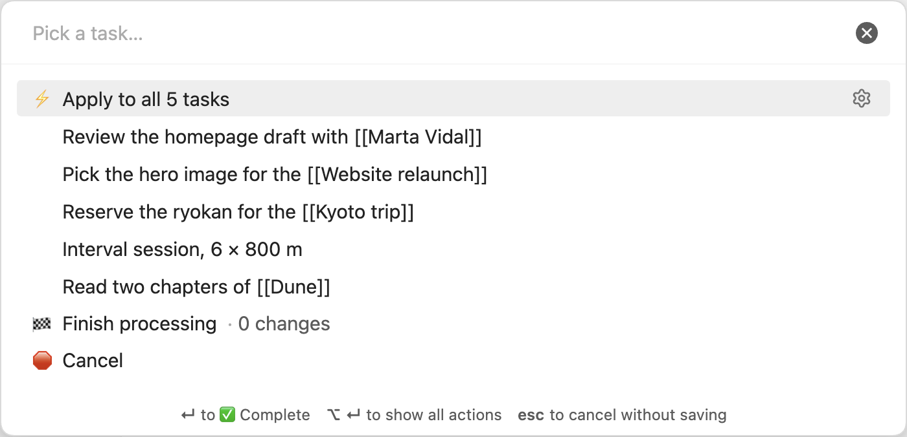
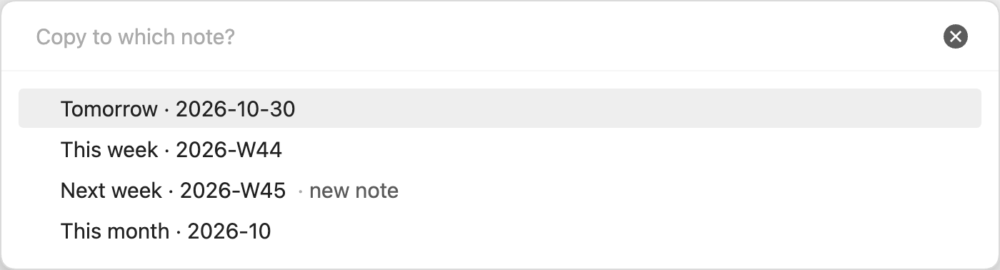
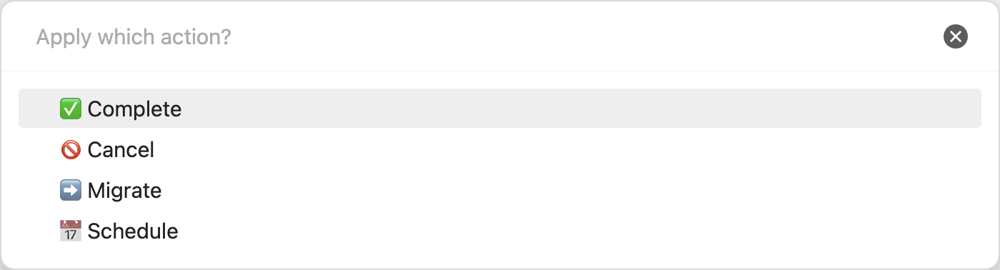

# Task commands

Process the tasks in the active Markdown note, or in any notes you choose, with your own command-palette commands, and cycle a task through your own statuses with a click.

[← Back to the README](../README.md)

## Quick start

1. Open Settings → Note Compass → Tasks and choose `+` to add a command.
2. Give it a name, then open a Markdown note with tasks and run that name from the command palette. You can also assign it a hotkey.
3. Type to find a task. Each key runs what "Keymap" binds to it; any other key, and ⚙, opens all actions.
4. With "Batch mode" on, choose `🏁 Finish processing` to save, or `🛑 Cancel` to discard the staged changes.

Only enabled commands with at least one action are offered. If no tasks match, a notice appears instead of an empty picker.

## Command page

Each command has its own page under Settings → Note Compass → Tasks.

| Section | Setting | What it does |
| --- | --- | --- |
| Command | Enabled, Name, Placeholder | Offers the command under this name in the command palette. The placeholder is the text in the task picker's search box, and it shows the name when left empty. |
| Sources | Source list | The notes whose tasks are listed. A new command reads the current note. Add, drag to reorder, switch, duplicate or delete sources. |
| Tasks to list | Status pills | Lists tasks with these checkbox characters. Empty means every task. |
| Tasks to skip | Status pills | Excludes these statuses even when listed above. Empty means none. |
| Options | Select all | Adds `⚡ Apply to all N tasks` when more than one task matches the typed search. |
| Options | Batch mode | Stages changes until you finish instead of writing immediately. |
| Actions | Action list | Add, drag to reorder, duplicate or delete actions; click a row to edit it inline. |
| Keymap | Key, Runs | Binds Enter, Cmd+Enter (Ctrl+Enter on Windows and Linux), Alt+Enter or Shift+Enter to an action, "Show the actions menu" or, in batch mode, `🏁 Finish processing`. Add with `+`, remove with ×. |

### Sources

A source offers the same choices as a navigation list, with "Current note" added: adjacent dates, links, same day, a [filter](settings.md#filters), notes linking to a note, notes modified today, current date notes, or the current note. Tasks are listed source by source, without repeating a note, and each note's tasks keep their order. When the tasks come from more than one note, each row shows its note's name.

A command whose sources need the note in focus, such as "Current note" or "Outbound links", is offered only while a Markdown note is open. A command with no switched-on source shows a warning. Copy destinations never include a note the chosen tasks come from, and changes are written to the note each task came from. Commands saved before sources existed read the current note, as before.

"Add status" offers Open `[ ]`, Completed `[x]`, Cancelled `[-]`, Migrated `[>]`, Scheduled `[<]`, In progress `[/]` and "Custom…". For a custom status, type one character and press Enter. Use a pill's × to remove it. Status characters are case-sensitive.

Each key appears at most once in "Keymap". A key with no entry opens the actions menu, so an empty "Keymap" opens the menu on every key. An action row shows a badge for each key bound to it. Deleting an action removes its keys, and a key bound to `🏁 Finish processing` opens the menu while "Batch mode" is off, with a warning on its row.

The main settings rows for commands and forms show only their name, with a second line only when there is a warning. An unreadable command is kept switched off with a warning until you remove it.

## Actions

Each action has a "Label", one "Action" kind and a one-character "Status".

### Change status

Changes the checkbox character on the source line. "Completion date" optionally appends a suffix.

| Completion date | Appended text |
| --- | --- |
| Off | Nothing. |
| Date | ` ✅ 2028-10-30` |
| Date as link | ` ✅ [[2028-10-30]]` |
| Timestamp | ` ✅ 2028-10-30 09:00` |

These are examples: dates use the daily-note format in "Date notes", and timestamps add the time format from the core Templates plugin. The date is today, not the source note's date. A date link does not create its note.

### Copy to note

Appends an open task `[ ]` to the end of another note and sets "Status" on the original. It copies only the task line, not its nested tasks or continuation lines; indentation and blockquote prefixes are not copied.

| Setting | What it does |
| --- | --- |
| Destinations | Opens a separate page; add with `+`, drag to reorder and use × to remove. The back arrow returns to the command. |
| Copied task prefix / suffix | Literal text around the copied body only, before its block ID and source link. Include any spaces; empty by default. Works immediately and in batches. |
| Link the destination | Adds ` → [[destination]]` to the original task. |
| Link the source | Adds ` ← [[source]]` to the copy. |

Destinations can be Today, Tomorrow, This week, Next week, This month, Next month, This quarter, Next quarter, This year, Next year or a Specific note.

- Periods are relative to today, not the source note's date, and use the enabled periods, folders and formats in "Date notes".
- One available destination runs directly; several open "Copy to which note?" in the configured order, marking any note still to be created as `new note`. The source note and duplicate destinations are never offered.
- Missing specific notes are skipped with a notice. If no destination remains, nothing changes.
- Missing periodic notes are created when changes are saved. When "Date notes" uses Date Compass or Periodic Notes, Note Compass first asks that plugin to create the note with its template. If that API is unavailable, fails or leaves the expected path missing, an empty note is created instead. Other sources, including core Daily notes and Custom, start empty before the task is appended.

## Picker and batch mode

Type to filter task text; matching is case-insensitive and in order, like the other pickers.

| Key or row | Does |
| --- | --- |
| A key from "Keymap" on a task | Runs the bound action on that task, or `🏁 Finish processing` writes all staged changes. |
| Any other key, or ⚙ | Opens the menu of all actions, including the bound ones. |
| `⚡ Apply to all N tasks` | Uses the chosen action on every task matching the search, not every task in the note. |
| `🏁 Finish processing` · N changes | Writes all staged changes and closes. |
| `🛑 Cancel` or Escape in the task picker | Discards all staged changes. |
| Escape in the action or destination picker | Goes back without discarding earlier staged changes. |

With "Batch mode" on, each choice is staged and the task picker reopens with the remaining tasks and an empty search. Processing the last task finishes automatically. Choosing `⚡ Apply to all N tasks` also finishes immediately, even if the search left other tasks hidden.

With "Batch mode" off, one choice writes immediately and closes the picker. Escape cannot undo a change already written. In either mode, source lines changed since the picker opened are skipped with a notice.

## New-command defaults

A new command starts with a Bullet Journal setup named "Process open tasks": enabled, listing only Open `[ ]`, skipping none, "Select all" off and "Batch mode" on. Its "Keymap" binds Enter to "✅ Complete", so Alt+Enter, Cmd+Enter and Shift+Enter open the actions menu.

| Action | Source status | Other settings |
| --- | --- | --- |
| ✅ Complete | `[x]` | Completion date Off. |
| 🚫 Cancel | `[-]` | Completion date Off. |
| ➡️ Migrate | `[>]` | Tomorrow, This week, Next week, This month; links the destination only. |
| 📅 Schedule | `[<]` | Next month, Next quarter, Next year; links both destination and source. |

## Statuses

Define the statuses your tasks use, step through the basic ones with a click, and pick any of them from a command, on desktop and on mobile.

1. Open Settings → Note Compass → Tasks → Statuses, and choose a status to open its page.
2. Give it a "Symbol", the character between the brackets, and a "Name". Leave the symbol empty for a plain list item without a checkbox.
3. Turn on "In the cycle" for the statuses a click steps through, and drag the rows into order.
4. Turn on "Cycle on click".

| You | What happens |
| --- | --- |
| Click or tap a checkbox in Live Preview or Reading view | The task moves to the next status in the cycle. After the last one, it starts again at the first. |
| Run "Cycle task status" | Every task and list item in the selection, or on the cursor's line, moves to its next status in the cycle. |
| Run "Set task status" | A picker lists every status, with ➡️ on the current one. The chosen status applies to every task and list item in the selection, or on the cursor's line. |

A new install has Open `[ ]`, In progress `[/]`, Completed `[x]` and Cancelled `[-]` in the cycle, plus Migrated `[>]` and Scheduled `[<]`.

- A task whose status is not in the cycle moves to the first status.
- A click skips the list item, so a task keeps its checkbox and goes from the last checkbox status back to the first. The commands include the list item.
- An invalid or repeated symbol shows a warning, and the status is skipped.
- Only the checkbox changes; no completion date is added. A plain or empty line becomes a list item or a task when a command runs on it alone, or as part of a selection when it has text; blank lines in a selection are skipped, and a click never converts a line.
- With "Cycle on click" off, a click toggles the checkbox as Obsidian does, and both commands still work.
- Checkboxes inside an embedded note keep Obsidian's own toggle.
- Give the commands hotkeys under Settings → Hotkeys.

### Status icons

Obsidian's default theme draws every status except `[ ]` as a checked box, so `[/]` and `[-]` look the same as `[x]`. "Draw status icons" fixes that, and each status's "Type" decides how it is drawn.

| Type | Drawn as |
| --- | --- |
| Todo, Done | Your theme's own checkbox, never redrawn. |
| In progress | A half-filled box. |
| Cancelled | A box with a dash, and the line struck through like a done task. |
| Other | The "Icon" you choose: any of the 324 solid [Heroicons](https://heroicons.com) bundled with the plugin, the set Minimal uses, searched by name with a preview, or "Theme default". |

- "Draw status icons" is off by default. Leave it off when your theme already styles these statuses, as Minimal does.
- "Icon" and "Colour" only show while "Draw status icons" is on.
- "Colour" sets the drawing's colour for In progress, Cancelled and Other: Theme default, Accent, Grey, or one of the theme's red, orange, yellow, green, cyan, blue, purple and pink, so it follows light and dark mode.
- A new install has Open as Todo, In progress as In progress, Completed as Done, Cancelled as Cancelled, and Migrated and Scheduled as Other with `paper-airplane` and `calendar`.

## Known behaviour

- Writes across several notes are not atomic: a failure can leave some notes updated and others unchanged.
- Copying keeps inline text, including existing suffixes and block IDs, so a copied block ID is duplicated rather than regenerated.

See [Settings](settings.md) and [Tips and known behaviour](tips.md).

These defaults apply only to new commands; saved destinations are unchanged.
